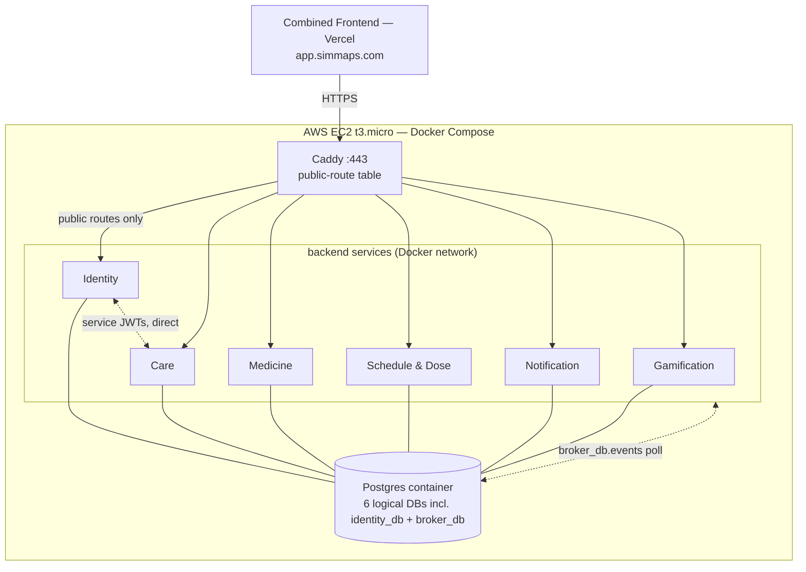
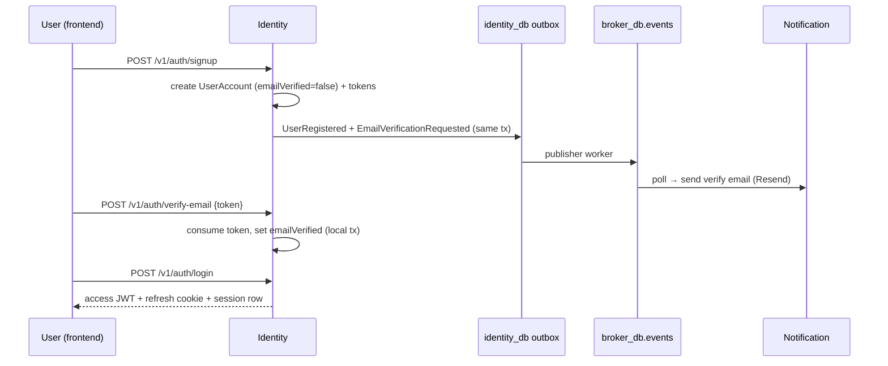
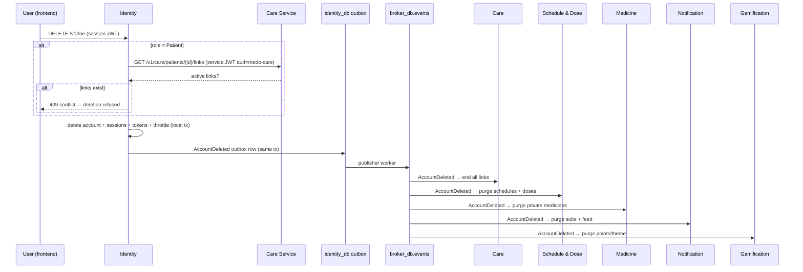
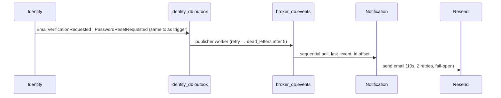
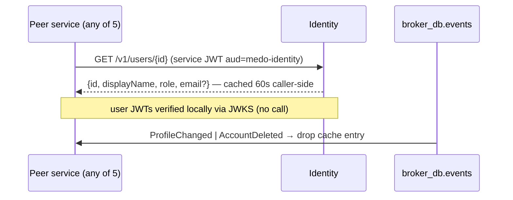

# HLD-MEDO-IDENTITY-001: Identity Service — accounts, authentication, sessions, directory

## 1. Document control header

Identity | backend-microservice | PRD-MEDO-IDENTITY-001@1.0 | approved

## 2. Design context and scope

### 2.1 Upstream PRD consumed

`PRD-MEDO-IDENTITY-001@1.0` (status: approved). Sections consumed by reference: §2 goals G-1…G-6 and non-goals NG-1…NG-8; §3 actors; §5 functional requirements FR-IDT-001…038 grouped 5.1 registration/verification, 5.2 auth/sessions/tokens, 5.3 password recovery, 5.4 profile, 5.5 directory, 5.6 deletion; §6 NFRs NFR-IDT-01…06; §9 data requirements; §10 contract inventory; §7.5 boundary statement. No requirement text is restated here (cite-don't-copy, hld-standard §6.1).

### 2.2 Component place in system

The Identity Service owns the Medo account aggregate and the platform's authentication root: credentials, profile fields, email-verification and password-reset tokens, per-device sessions/refresh tokens, login-throttle state, the user directory lookup, JWKS publication, and all auth endpoints (`service-catalog.md#identity-service@2026-11-22`; PRD §7.5). It is the issuer of user access JWTs and the owner of the session store — the only service that persists refresh credentials.

It does NOT own: Care Links/invites/check-link (Care Service); Medicines, the Medicine Catalog, schedules, dose rows, outcomes (Medicine / Schedule & Dose); notification preferences, push subscriptions, feed rows, or delivery of the verify/reset emails Identity requests via events (Notification Service); Harmony Points and theme state (Gamification Service); API-gateway routing (Caddy, ticket 05).

### 2.3 Design goals

- DG-ID-1: Identity is the single source of truth for account facts; every other service reaches user data only through `GET /v1/users/{id}`, JWKS verification, or `userId` references — never peer data access. [`PRD-MEDO-IDENTITY-001@1.0#G-4`; `service-catalog.md#conventions@2026-11-22`]
- DG-ID-2: Two trust domains held at this boundary — user JWTs (Identity-issued, JWKS-verified everywhere) and per-service JWTs (`aud=medo-identity` required on the internal route) — with no end-user token forwarded to internal callers. [`.scratch/medo-backend/issues/06-auth-token-mechanics.md@2026-11-21`]
- DG-ID-3: Patient-scoped authorization is never decided here; the only peer call is the synchronous Care links check inside deletion, fail-closed. [FR-IDT-033…035; `service-catalog.md#care-service@2026-11-22`]
- DG-ID-4: Every event-emitting write is transactional-outbox wrapped; publication is at-least-once and consumers dedupe — no silent event loss. [`.scratch/medo-backend/issues/07-message-broker-event-transport.md@2026-11-21`]
- DG-ID-5: Refresh credentials exist only as SHA-256 hashes in `identity_db`; the raw token travels only in the `HttpOnly` cookie. [PRD §9.5; ticket 06 Q3]
- DG-ID-6: The service stays stateless at the process level except its database — restart/deploy loses nothing except in-memory rate-limit windows. [ticket 09; `scheduled-jobs.md#pattern@2026-11-21`]

### 2.4 Design non-goals

- Exact DTO field lists, table/column shapes, token-format internals, and route handler structure → LLD.
- JWT signing-key compromise runbook and `kid` rollover procedure → LLD/ops (approach fixed by HD-ID-05; OQ-HLD-ID-01).
- Auth-email content/templates and Resend delivery → Notification Service HLD.
- Frontend auth screens, token storage client-side, Dexie behavior → Frontend HLD.
- Rate-limit numeric tuning beyond locked defaults → LLD config.

### 2.5 Inherited locked decisions

- Runtime/framework: Node.js + TypeScript + Fastify + Drizzle ORM (`inherited:.scratch/medo-backend/issues/01-backend-runtime-framework.md@2026-11-20`).
- Deployment/hosting: single AWS EC2 `t3.micro` + Docker Compose; frontend Vercel; `.env` local / SSM Parameter Store prod; Budget alert $25 (`inherited:…/02-deployment-model-hosting.md@2026-11-20`).
- Database: self-hosted Postgres container, six logical DBs with per-service users, `drizzle-kit` migrations; `identity_db` + own DB user (`inherited:…/03-database-technology.md@2026-11-21`).
- Object storage: Cloudflare R2 — not used by Identity (`inherited:…/04-object-storage-provider.md@2026-11-21`; N/A binding).
- API gateway: Caddy reverse proxy, explicit public-route table, per-service JWT verify, proxy-level CORS, refresh cookie `HttpOnly; Secure; SameSite=Lax; Path=/v1/auth` host-only on `api.<domain>` (`inherited:…/05-api-gateway-entry-point.md@2026-11-21`).
- Auth token mechanics: asymmetric user-JWT keypair + public JWKS; claims `iss/aud/sub/role/sid/iat/exp(25m)/jti`; hashed session rows + rotation + reuse detection; per-service asymmetric service JWTs, 5-min `aud`-scoped, minted per call, static pubkey config, private keys SSM/`.env` (`inherited:…/06-auth-token-mechanics.md@2026-11-21`).
- Event transport: per-service transactional outbox → publisher → `broker_db.events`; sequential in-order per consumer, `last_event_id` offset, `eventId` dedupe, 5 attempts → `broker_db.dead_letters`; `@medo/eventing` shared package (`inherited:…/07-message-broker-event-transport.md@2026-11-21`).
- Observability: Pino JSON + `X-Request-Id`/`eventId`; per-service `/metrics`, `/health`, `/ready`; Sentry per service (`inherited:…/08-observability.md@2026-11-21`; `platform-observability.md@2026-11-21`).
- Rate limiting & caching: per-service Fastify plugin, in-memory sliding window; public 30/min/IP, auth'd writes 60/min/userId, auth'd reads 300/min/userId, internal exempt; 429 + `Retry-After`; Identity directory cache is a *caller-side* obligation of other services, not this service (`inherited:…/09-rate-limiting-caching.md@2026-11-21`).
- Notification prefs owned by Notification Service — Identity stores no preference state (`inherited:…/10-notification-preferences-scope.md@2026-11-21`).
- Domain: `simmaps.com` — `app.simmaps.com` (Vercel), `api.simmaps.com` (Caddy→EC2), `photos.simmaps.com` (R2) (`inherited:.scratch/medo-hld/issues/01-domain-selection.md@2026-11-22`).
- Deploy mechanism: `medo-infra` repo (`compose.yml` + `Caddyfile` + `deploy.sh`); git-SHA images on GHCR; `deploy.sh` health-gates `/health`+`/ready` ~60 s with auto-rollback to `.last-good` (`inherited:.scratch/medo-hld/issues/02-cicd-deploy-mechanism.md@2026-11-23`).
- Quality/ops baselines: `platform-quality-baseline.md@2026-11-21`, `scheduled-jobs.md@2026-11-21`, `platform-observability.md@2026-11-21`.

## 3. System context

FIG-ID-01: system context diagram

```mermaid
flowchart LR
    subgraph Users
        P[Patient]
        C[Caregiver]
    end
    FE[Combined Frontend<br/>app.simmaps.com]
    ID[Identity Service]
    CARE[Care Service]
    MED[Medicine Service]
    SCH[Schedule & Dose Service]
    NOT[Notification Service]
    GAM[Gamification Service]
    CADDY[Caddy reverse proxy<br/>api.simmaps.com]
    BROKER[(broker_db.events<br/>+ dead_letters)]

    P --> FE
    C --> FE
    FE -->|public auth REST + /v1/me| CADDY
    CADDY --> ID
    ID -->|GET /v1/care/patients/{id}/links<br/>service JWT aud=medo-care| CARE
    ID -->|outbox publish| BROKER
    BROKER -->|poll| NOT
    BROKER -->|poll| CARE
    BROKER -->|poll| MED
    BROKER -->|poll| SCH
    BROKER -->|poll| GAM
    CARE -->|GET /v1/users/{id} + JWKS verify| ID
    MED -->|GET /v1/users/{id} + JWKS verify| ID
    SCH -->|GET /v1/users/{id} + JWKS verify| ID
    NOT -->|GET /v1/users/{id} + JWKS verify| ID
    GAM -->|GET /v1/users/{id} + JWKS verify| ID
```

| Counterparty | Relationship (calls/consumes/publishes/is-called-by) | Contract(s) |
|---|---|---|
| Patient / Caregiver (via Combined Frontend) | is-called-by | All public REST rows §7.1 (`/v1/auth/*`, `/v1/me`, `DELETE /v1/me`) |
| Combined Frontend | calls through Caddy; never calls internal routes | §7.1 public rows; `frontend-map.md#per-screen-service-calls@2026-11-22` auth + profile rows |
| Caddy reverse proxy | pass-through entry; terminates CORS; sets nothing auth-related | `inherited:ticket-05@2026-11-21` |
| Care Service | called-by (sync, deletion check only); is-called-by (directory + JWKS for its user-JWT verification and cache) | Consumes `GET /v1/care/patients/{id}/links`; exposes-side `GET /v1/users/{id}`, `GET /.well-known/jwks.json` |
| Medicine / Schedule & Dose / Notification / Gamification Services | is-called-by (`GET /v1/users/{id}`, JWKS); consume `AccountDeleted`, `ProfileChanged` (directory-cache invalidation per ticket 09) | §7.1 internal row + JWKS; §8.1 events |
| Notification Service | consumes `EmailVerificationRequested`, `PasswordResetRequested`, `AccountDeleted` | §8.1 events |
| `broker_db` event fabric | publishes via own outbox; never consumes | §8.1; `inherited:ticket-07@2026-11-21` |
| Cloudflare R2 | no interaction — photo storage is Medicine-owned | none (explicit none) |
| Resend / Web Push | no direct interaction — delivery owned by Notification | none (explicit none) |

## 4. Application topology and service boundaries

### 4.1 Deployable unit & entry path

Identity runs as the `identity` container in the single Docker Compose stack on the AWS EC2 `t3.micro` (region ap-south-1 recommended, confirmed at deploy), alongside the other five services and the shared Postgres container (`inherited:ticket-02@2026-11-20`, `ticket-03@2026-11-21`, `.scratch/medo-hld/issues/02-cicd-deploy-mechanism.md@2026-11-23`). Public traffic enters via `api.simmaps.com` → Caddy → explicit public-route table → `identity` (`inherited:ticket-05@2026-11-21`, `.scratch/medo-hld/issues/01-domain-selection.md@2026-11-22`). Service-to-service calls go direct on the Docker network with per-service JWTs. Deploys are manual SSH via `medo-infra` (`deploy.sh` health-gates + rollback) pulling git-SHA images from GHCR.

### 4.2 Boundary statement

Mirroring `service-catalog.md#identity-service@2026-11-22` and PRD §7.5: Identity solely owns the account aggregate — credentials, profile fields (`displayName`, `timezone`, `role`, `email`, `emailVerified`), verify/reset tokens, sessions/refresh tokens, login-throttle state — plus the auth endpoints, `GET /v1/users/{id}` directory, and JWKS publication.

Denied capabilities (explicit): no Care Link or invite state (Care); no medicine/catalog/schedule/dose data (Medicine, Schedule & Dose); no notification preferences, push subscriptions, feed, or email delivery (Notification); no Harmony Points/theme (Gamification); no API-gateway logic (Caddy); no patient-scoped resource authorization (Care check-link is the sole authz path for patient data).

### 4.3 Boundary invariants

- Own repository, own logical database `identity_db` in the shared Postgres container with own DB user; cross-DB access prohibited — peers are reached only via contracts/events (`inherited:ticket-03@2026-11-21`).
- No shared domain models or schemas with peer services; DTOs at every boundary (`service-catalog.md#conventions@2026-11-22`).
- Four logical layers `Infrastructure / Core / Application / WebAPI` per Architecture Standard; every §5 block carries exactly one primary layer (cross-layer justified inline).
- Read/write flow pattern: writes WebAPI → Application → Core → Infrastructure → `identity_db`; reads reverse; event-emitting writes additionally write the outbox row in the same transaction (`inherited:ticket-07@2026-11-21`). Deviation: the deletion workflow performs a synchronous peer call (Care links check) *before* the local transaction — recorded as HD-ID-06.

FIG-ID-02: topology position



## 5. Decomposition and internal structure

| Block | Responsibility | Layer | Contracts/events | HD-ref |
|---|---|---|---|---|
| `webapi-auth` | HTTP presentation for all public auth routes + `/v1/me` + JWKS; DTO validation boundary | WebAPI | §7.1 public rows | — |
| `webapi-internal` | HTTP presentation for `GET /v1/users/{id}`; service-JWT gate | WebAPI | §7.1 internal row | — |
| `account-core` | Account lifecycle rules: signup/duplicate check, credential verification, profile field rules, emailVerified gate | Core | `POST /v1/auth/signup`, `verify-email`, `resend-verification`, `GET/PATCH /v1/me` | HD-ID-04 |
| `session-core` | Session/token rules: login issue, refresh rotation + reuse detection, logout/logout-all revocation, reset/verify token consume, password reset | Core | `login`, `refresh`, `logout`, `logout-all`, `forgot-password`, `reset-password` | HD-ID-03 |
| `throttle-core` | Business throttles: login-failure cooldown per email+IP, forgot-password 2/hr per email | Core | `login`, `forgot-password` | HD-ID-02 |
| `directory-core` | Directory DTO assembly + JWKS key-set publication from signing-key config | Core | `GET /v1/users/{id}`, `GET /.well-known/jwks.json` | HD-ID-05 |
| `deletion-workflow` | Account-deletion orchestration: session auth → Care links check (Patient only) → local purge → `AccountDeleted` | Application | `DELETE /v1/me`; consumes `GET /v1/care/patients/{id}/links`; publishes `AccountDeleted` | HD-ID-06 |
| `persistence` | `identity_db` repositories + transactional outbox writes for all five events | Infrastructure | §8.1 published events | — |
| `eventing` | Outbox publisher worker → `broker_db.events` (via `@medo/eventing`) | Infrastructure | §8.1 | — |
| `rate-limit` | Per-route sliding-window limiter plugin (public/auth'd classes) + 429/`Retry-After` | WebAPI | all §7.1 rows | — |
| `auth-cleanup` | Daily `04:30 UTC` purge of expired tokens + expired/revoked sessions | Application | §15 | — |

Read/write flow: HTTP requests enter `webapi-*` (Zod DTO validation, rate-limit plugin), are orchestrated by `deletion-workflow`/`auth-cleanup` or delegated to `*-core` rules via `persistence` repositories; `eventing` drains the outbox independently. The only cross-layer deviation is the synchronous Care call inside `deletion-workflow` (peer call before local tx — HD-ID-06).

## 6. Data architecture

### 6.1 Owned store & entity inventory

Owned store: `identity_db` — sole ownership; never shared, never read by peers (`PRD-MEDO-IDENTITY-001@1.0#9.1`; `inherited:ticket-03@2026-11-21`). Persistence approach: PostgreSQL + Drizzle ORM + `drizzle-kit` migrations at deploy (`inherited:ticket-01/03`). Shape classification at approach level: relational entity set plus transactional outbox table (`inherited:ticket-07@2026-11-21`; no `HD-` needed — uniform platform pattern).

Entity inventory (ownership granularity, lifecycle per PRD §9.1 — cited, not re-derived):

| Entity | Lifecycle class | Notes |
|---|---|---|
| UserAccount (credentials, role, email, displayName, timezone, emailVerified) | create → read/update → delete | password stored as salted adaptive hash only (FR-IDT-003; KDF class HD-ID-04) |
| AuthSession (per-device refresh-token row) | create → rotate → revoke → purge | SHA-256 hash only; raw token never stored |
| VerifyToken / PasswordResetToken | create → consume-or-expire → purge | single-use; TTLs per PRD §9.4 |
| LoginThrottle state (email+IP failure counts, cooldown markers) | request-time create/update/expire | DB-backed per HD-ID-02 |
| Outbox rows (5 event types) | insert same-tx → publish → delete | `@medo/eventing` pattern |

### 6.2 Shared / consumed data

- Consumed (read-only, sync): active Care Links for a deleting Patient via `GET /v1/care/patients/{id}/links` — provider Care Service; no caching (deletion must see current state); fail-closed (FR-IDT-035). Contract-level only; no schema replication.
- Shared/community data: none — Identity owns no shared entities (PRD §9.3).
- Read-through data owned elsewhere: none — Identity never reads peer databases.

### 6.3 Consistency & coordination model

- Local transaction ownership: every `identity_db` write is one local transaction; event-emitting writes commit the domain change + outbox row atomically (`inherited:ticket-07@2026-11-21`).
- Cross-service workflows (§8.4): deletion = synchronous contract call (Care links check, fail-closed) followed by local delete + `AccountDeleted` event — coordination model per workflow in §8.4. Auth emails = event-driven (`EmailVerificationRequested`/`PasswordResetRequested` → Notification) — Identity never calls Resend.
- Event consistency: outbox → publisher → `broker_db.events` → per-consumer sequential poll, `last_event_id` offset, at-least-once + `eventId` dedupe, 5 attempts → `dead_letters` (`inherited:ticket-07@2026-11-21`). Identity publishes only; consumes no events.
- Directory-cache consistency is caller-side: consumers hold 60 s TTL caches invalidated on `ProfileChanged`/`AccountDeleted` (`inherited:ticket-09@2026-11-21`) — Identity's obligation is only to emit those events on the triggering writes.

### 6.4 Retention & deletion

Per `platform-quality-baseline.md#data-retention@2026-11-21` + `scheduled-jobs.md#identity-service@2026-11-21`, Identity-owned obligations:

- Verify/reset tokens: TTL expiry (24 h verify / 60 min reset), purged by `auth-cleanup` daily `04:30 UTC`.
- Sessions/refresh tokens: retained until logout/revoke/reset/account-delete; expired+revoked purged daily by `auth-cleanup`; sliding ~30-day lifetime per PRD.
- LoginThrottle state: expires with its window (DB rows purged by `auth-cleanup` sweep of expired throttle records — see §15.2).
- Account deletion (`DELETE /v1/me` proceeding): account row + all sessions, tokens, and throttle state deleted in the same transaction that writes the `AccountDeleted` outbox row (FR-IDT-036/037); Identity does not consume its own event.
- Backups: none in v1 — accepted risk (`platform-quality-baseline.md`).

## 7. External contracts

### 7.1 Exposed contracts

| Contract (verbatim) | Block | Sync/Async | Public/Internal | Authz binding | Idempotent? | Rate-limit class | Catalog ref |
|---|---|---|---|---|---|---|---|
| `POST /v1/auth/signup` | `account-core` via `webapi-auth` | REST sync | public | public + rate-limited | no — duplicate email → conflict | public 30/min/IP | catalog §Identity public REST |
| `POST /v1/auth/login` | `session-core` + `throttle-core` via `webapi-auth` | REST sync | public | public + cooldown rules | no | public 30/min/IP + business cooldown | catalog §Identity public REST |
| `POST /v1/auth/refresh` | `session-core` via `webapi-auth` | REST sync | public | refresh cookie | rotation makes replay detectable | public 30/min/IP | catalog §Identity public REST |
| `POST /v1/auth/logout` | `session-core` via `webapi-auth` | REST sync | public | session | yes | auth'd write 60/min/userId | catalog §Identity public REST |
| `POST /v1/auth/logout-all` | `session-core` via `webapi-auth` | REST sync | public | session | yes | auth'd write 60/min/userId | catalog §Identity public REST |
| `POST /v1/auth/forgot-password` | `session-core` via `webapi-auth` | REST sync | public | public + 2/hr per email | yes — identical response | public 30/min/IP + 2/hr business rule | catalog §Identity public REST |
| `POST /v1/auth/reset-password` | `session-core` via `webapi-auth` | REST sync | public | reset token (single-use) | token single-use | public 30/min/IP | catalog §Identity public REST |
| `POST /v1/auth/verify-email` | `account-core` via `webapi-auth` | REST sync | public | verify token (single-use) | token single-use | public 30/min/IP | catalog §Identity public REST |
| `POST /v1/auth/resend-verification` | `account-core` via `webapi-auth` | REST sync | public | public + rate-limited | yes | public 30/min/IP | catalog §Identity public REST |
| `GET /v1/me` | `account-core` via `webapi-auth` | REST sync | public | session (own profile) | n-a | auth'd read 300/min/userId | catalog §Identity public REST |
| `PATCH /v1/me` | `account-core` via `webapi-auth` | REST sync | public | session (own profile) | yes — last-write-wins | auth'd write 60/min/userId | catalog §Identity public REST |
| `DELETE /v1/me` | `deletion-workflow` via `webapi-auth` | REST sync | public | session (own account) | yes — repeat → 404 | auth'd write 60/min/userId | catalog §Identity public REST |
| `GET /v1/users/{id}` | `directory-core` via `webapi-internal` | REST sync | internal | service JWT `aud=medo-identity` only | n-a | internal exempt | catalog §Identity internal REST |
| `GET /.well-known/jwks.json` | `directory-core` via `webapi-auth` | REST sync | public | none — public keys | n-a | public 30/min/IP | platform surface per Map3 t06 — outside catalog `/v1` scope (see §7.3 note) |

Rate-limit classes per `inherited:ticket-09@2026-11-21` defaults; business rules (login cooldown, forgot 2/hr) are PRD-locked and stack on top of the public class. Session-authenticated routes are keyed by `userId` (`sid` claim), public routes by IP.

### 7.2 Consumed contracts

| Contract (verbatim) | Provider | Sync/Async | Public/Internal | Cache/staleness binding | Failure ref (§14) | Catalog ref |
|---|---|---|---|---|---|---|
| `GET /v1/care/patients/{id}/links` | Care Service | sync REST | internal | none — deletion must see current state | §14 row CARE-LINKS | catalog §Care internal REST |

### 7.3 Contract realization notes (backend profile §4.3/§4.5)

- Route groups: `webapi-auth` hosts all public `/v1/auth/*`, `/v1/me`, and JWKS; `webapi-internal` hosts `GET /v1/users/{id}`. `DELETE /v1/me` is realized by `deletion-workflow` (orchestration), not a thin core rule.
- Shared aggregate: UserAccount underlies signup/login/verify/profile/directory — one aggregate, multiple route groups.
- Thin proxies: none — every route executes Core rules against `identity_db`.
- Sync fan-out to peers: exactly one — `deletion-workflow` → Care links check (timeout/retry/fail-mode per §14; no fan-out elsewhere).
- Internal surface: `GET /v1/users/{id}` only; callee-side expectation `iss=medo-<caller>`, `aud=medo-identity`, 5-min token (`inherited:ticket-06@2026-11-21`); unreachable via Caddy public table AND independently service-JWT gated (`inherited:ticket-05@2026-11-21` Q4).
- Caller-side caching obligations: none owned by Identity — the 60 s directory cache is an obligation of *consumers* (`inherited:ticket-09@2026-11-21`).
- JWKS note: `GET /.well-known/jwks.json` is unversioned platform surface mandated by Map3 t06 (public key distribution for user-JWT verification); it is not a `/v1` catalog route and requires no catalog amendment — flagged here for reviewer awareness, not a `contract-gap`.

## 8. Integration events and workflows

### 8.1 Published events

All five events are produced by `persistence` outbox writes inside the same transaction as their triggering domain write; `eventing` publishes via `@medo/eventing`. Ordering within Identity's stream: events are independent — no ordering guarantee is offered or required; consumers must tolerate any order (PRD §10.3). Dedup: at-least-once delivery; consumers dedupe on `eventId`.

| Event (verbatim) | Block | Trigger | Consumers | Ordering/dedup notes |
|---|---|---|---|---|
| `UserRegistered` | `account-core`/`persistence` | signup commit | none (catalog event table) | independent; `{userId, role}` |
| `EmailVerificationRequested` | `account-core`/`persistence` | signup commit; `resend-verification` | Notification | independent; `{userId, email, verifyLink}` |
| `PasswordResetRequested` | `session-core`/`persistence` | `forgot-password` for registered email | Notification | independent; `{userId, email, resetLink}` |
| `ProfileChanged` | `account-core`/`persistence` | successful `PATCH /v1/me` | all services holding directory cache (invalidations per ticket 09); catalog event table lists no domain consumer | independent; `{userId, changedFields[]}` |
| `AccountDeleted` | `deletion-workflow`/`persistence` | deletion commit | Care, Medicine, Schedule & Dose, Notification, Gamification | independent; `{userId}` |

### 8.2 Consumed events

None — explicit statement per catalog (`service-catalog.md#identity-service@2026-11-22`: "Consumes: none"). The Care links check is a synchronous REST call, not an event.

### 8.3 Explicit none-statements

- Consumes no events (§8.2).
- Publishes exactly the five catalog events; no additional events (no `PointsChanged`-style extras — none exist for Identity).
- No scheduled publication; all events are request-transaction driven.

### 8.4 Cross-service workflows

| Workflow | FIG | Coordination model per hop | Failure semantics |
|---|---|---|---|
| Account activation (signup → verify → login) | FIG-ID-04-1 | signup: local tx + `UserRegistered`/`EmailVerificationRequested` outbox; verify: local tx consume token; login: local credential check → session row + JWT | Outbox retry → `dead_letters` after 5 attempts; verify token single-use rejects replay; unverified login denied per FR-IDT-008 |
| Account deletion cascade | FIG-ID-04-2 | `DELETE /v1/me` → session auth → sync `GET /v1/care/patients/{id}/links` (Patient only, fail-closed) → local tx (delete account+sessions+tokens+throttle + `AccountDeleted` outbox) → event fan-out purge | Care timeout/error → refuse deletion, retryable 503-class (§14); outbox guarantees `AccountDeleted` delivery; consumers idempotent per ticket 07 |
| Auth-email delivery | FIG-ID-04-3 | Identity outbox → `broker_db.events` → Notification consumer → Resend | Notification-side Resend fail-open per baseline; Identity side unaffected (event already committed) |
| Directory read + cache invalidation | FIG-ID-04-4 | peer services call `GET /v1/users/{id}` (60 s caller cache) + verify user JWTs via JWKS; `ProfileChanged`/`AccountDeleted` events drop cache entries | Directory 503 → callers serve stale cache ≤60 s then fail per their own §14; JWKS endpoint public + cacheable by verifiers per ticket 06 |

FIG-ID-04-1: account activation



FIG-ID-04-2: account deletion cascade



FIG-ID-04-3: auth-email delivery



FIG-ID-04-4: directory read + invalidation



## 9. Frontend contract surface

| frontend-map row | Screen/module | Contract IDs used | Sync pattern | Offline classification |
|---|---|---|---|---|
| Auth: signup / login / refresh / logout / forgot / reset / verify-email | Auth screens | `POST /v1/auth/signup`, `login`, `refresh`, `logout`, `logout-all`, `forgot-password`, `reset-password`, `verify-email`, `resend-verification` | sequential user-driven flow (not fan-out — single auth call per action) | API-only — never Dexie-cached; refresh via cookie through proxy |
| Own profile (view/edit) | Profile screen | `GET /v1/me`, `PATCH /v1/me`, `DELETE /v1/me` | single call per action | API-only — profile not in Dexie cached-entity set (`frontend-map.md#dexie-offline-sync-contract@2026-11-22`) |

`patientId` rule binding: for Patient accounts `patientId` = Identity `userId`; Identity exposes no patient-scoped routes — the rule binds downstream services only (`frontend-map.md` conventions). Offline implications: no Identity contract is Dexie-cached and no Identity write enqueues to the write-queue (write-queue carries dose outcomes only). Account deletion is API-only and requires connectivity — consistent with the offline contract (no offline delete requirement exists).

## 10. Cross-cutting concerns

### 10.1 Authentication & authorization summary

Two trust domains (`inherited:ticket-06@2026-11-21`):

- **User JWTs** — issued here; verified by every service locally against `GET /.well-known/jwks.json` (or static pubkey config). Claims `iss/aud/sub/role/sid/iat/exp(25m)/jti`. Session-scoped routes (`logout`, `logout-all`, `GET/PATCH/DELETE /v1/me`) require a valid access JWT; the frontend attaches `Authorization: Bearer`.
- **Service JWTs** — per-service asymmetric keys; `GET /v1/users/{id}` requires `aud=medo-identity`, 5-min token minted per call by the caller. User tokens and anonymous calls rejected (FR-IDT-031).

Identity is the issuer, not a check-link consumer: it performs no patient-scoped authz — the Care links check inside deletion is a data read for a business rule, not an authz delegation. Authz level per contract is stated in §7.1; mechanism detail is LLD.

### 10.2 Observability binding

Per `platform-observability.md@2026-11-21` with Identity deltas:

- Logs: Pino JSON, `service=identity`, `requestId`/`eventId` correlation; never log passwords, hashes, raw tokens, or reset/verify links.
- `GET /metrics` (service-JWT gated, internal): fixed RED set + Identity counters — login failures, cooldown activations, refresh-rotation reuse revocations, session revocations, `auth-cleanup` run success/fail, outbox backlog, `broker_db` lag, `dead_letters` count (PRD NFR-IDT-06).
- Sentry project: `medo-identity` (DSN via env/SSM).
- `GET /health` public liveness; `GET /ready` internal readiness — dependency checks: own `identity_db` ping + `broker_db` ping (publisher dependency). Deps named: `identity_db`, `broker_db`.

### 10.3 Resilience binding

Identity's dependency rows from `platform-quality-baseline.md#resilience-defaults@2026-11-21`:

| Dependency | Binding |
|---|---|
| Own Postgres (`identity_db`) | 5 s fast-fail → 503; cited, no delta |
| Care `GET /v1/care/patients/{id}/links` (internal REST row) | 3 s timeout + 1 retry/200 ms → fail-closed deny = refuse deletion, retryable error (FR-IDT-035); cited |
| `broker_db` event transport (publisher) | outbox retry built into `@medo/eventing`; 5 attempts → `dead_letters`; cited |
| Resend / Web Push / R2 | N/A — Identity has no direct external provider calls (delivery owned by Notification; stated PRD §11.1) |

### 10.4 Rate limiting & caching

Per `inherited:ticket-09@2026-11-21`: per-service Fastify plugin, in-memory sliding window; defaults public 30/min/IP, auth'd writes 60/min/userId, auth'd reads 300/min/userId, internal exempt, 429 + `Retry-After`. Identity deltas: none numeric — business rules stack on top (login 3-fail→25 min cooldown per email+IP persisted per HD-ID-02; forgot-password 2/hr per email; these are PRD/catalog-locked, not rate-limit-plugin overrides). Caches owned by Identity: none — the directory cache lives in consumers; Identity caches nothing (JWKS key set is config, not a cache).

### 10.5 Error handling & input protection

Standard JSON error body platform-wide; `Retry-After` on 429; fail-cleanly rule (clear 4xx/5xx, never crash/hang; degrade where cheap; no silent data loss) per `platform-quality-baseline.md#availability`. DTO-at-boundary with Zod validation at `webapi-*` (`inherited:ticket-01@2026-11-20` libs). Enumeration posture: signup conflict, identical forgot-password response, uniform login failure — all PRD-locked (FR-IDT-002/011/022).

### 10.6 Sensitive-data handling

PII: email + displayName (PRD §9.5). Credentials material: password hash, refresh-token hashes, verify/reset token hashes — stored hashed, never in DTOs, logs, or events. JWT private signing key + service private key: SSM Parameter Store (prod) / `.env` (local) — never in repo or logs (`inherited:ticket-06@2026-11-21`). Login-throttle keys on email+IP; IP retained only within the throttle window (HD-ID-02 governs storage class). Event payloads carry minimal fields only (`{userId, role}`, `{userId, email, verifyLink}`, etc. per catalog) — the minimal-change rule doubles as data minimization; verify/reset links are bearer secrets carried only inside the auth-email events to Notification.

## 11. Security architecture

### 11.1 Trust boundaries

| Boundary | Mechanism | Binding |
|---|---|---|
| Internet → Caddy → Identity (public routes) | explicit public-route table only; unlisted = 404; user JWT verified per-service | `inherited:ticket-05@2026-11-21` |
| Service → Identity internal route | service JWT `aud=medo-identity`, independently gated (defense in depth behind route table) | `inherited:ticket-05/06` |
| Frontend → API | `Authorization: Bearer` access JWT; refresh cookie `HttpOnly; Secure; SameSite=Lax; Path=/v1/auth`, host-only on `api.simmaps.com`, set by Identity via proxy | `inherited:ticket-05@2026-11-21`; `.scratch/medo-hld/issues/01-domain-selection.md@2026-11-22` |
| CORS | terminated once at Caddy; exact-origin allowlist + `Allow-Credentials`; no wildcard+credentials | `inherited:ticket-05@2026-11-21` |
| Identity → Care (deletion check) | service JWT `aud=medo-care`, minted per call | `inherited:ticket-06@2026-11-21` |

### 11.2 Token lifecycle binding

Identity owns the session store — the only stateful trust-domain component (`inherited:ticket-06@2026-11-21`):

- Access JWT: 25-min stateless; revocation lag ≤25 min accepted by design (ticket 06 Q4); verified via JWKS/static config — no per-request session lookup.
- Refresh token: ~30-day sliding; stored SHA-256 hashed in `AuthSession` rows; rotation on every refresh; replayed rotated/revoked token = reuse → session revoked (fail-safe).
- Revocation triggers: `logout` (one row), `logout-all` (all rows), `reset-password` (all rows), account deletion (all rows + account purge) — all PRD-locked.
- Verify/reset tokens: single-use, TTL-bound (24 h / 60 min), consumed atomically at use.
- JWKS rotation approach: HD-ID-05; residual operational detail → OQ-HLD-ID-01 (non-blocking).

### 11.3 Data exposure analysis

- Directory DTO `{id, displayName, role, email?}` — minimal fields, no credentials/tokens/internal fields (FR-IDT-030); internal-only exposure class.
- `GET /v1/me` returns own profile incl. `emailVerified` per FR-IDT-027 (resolves PRD OQ-IDT-04 — see §18.4).
- Verify/reset links are bearer secrets: they appear only in `EmailVerificationRequested`/`PasswordResetRequested` payloads to Notification and in the auth-email to the user — never in logs, metrics labels, or other events.
- JWKS exposes public keys only — safe public surface.
- Signed-URL photo flow: N/A — Identity stores no photos (Medicine/R2-owned).
- PII classes: email + displayName at rest in `identity_db`; IP addresses transient in throttle state only.

### 11.4 Abuse controls

| Control | Binding |
|---|---|
| Public rate limit 30/min/IP on all public routes | `inherited:ticket-09@2026-11-21` |
| Login cooldown 3-fail → 25 min per email+IP | PRD FR-IDT-012…014; store HD-ID-02 |
| Forgot-password 2/hr per email + identical response | PRD FR-IDT-022/024 |
| Verify/reset token single-use + TTL | PRD FR-IDT-006/007/023/025/026 |
| Refresh rotation + reuse detection → session revoke | `inherited:ticket-06@2026-11-21` |
| Signup duplicate → conflict (no enumeration via signup) | PRD FR-IDT-002 |
| Internal route double-gated (route table + service JWT) | `inherited:ticket-05@2026-11-21` |

No new security choice beyond HD records — nothing flagged for approval.

## 12. Deployment topology and assumptions

### 12.1 Runtime & platform binding

Node.js + TypeScript + Fastify + Drizzle (`inherited:ticket-01@2026-11-20`); `identity` container in the shared Docker Compose stack on AWS EC2 `t3.micro` (ap-south-1 recommended) with five peer services + one Postgres container hosting `identity_db` among six logical DBs (`inherited:ticket-02/03@2026-11-20/21`). Frontend on Vercel at `app.simmaps.com` (`inherited:.scratch/medo-hld/issues/01-domain-selection.md@2026-11-22`).

### 12.2 Entry path & network position

`app.simmaps.com` (browser) → `api.simmaps.com` → Caddy public-route table → `identity` container. Internal `GET /v1/users/{id}` is not in the public table (404 at edge) and is independently service-JWT gated. Peers reach Identity directly on the Docker network for directory/JWKS needs; events flow via `broker_db` tables in the same Postgres container (`inherited:ticket-05/07`).

### 12.3 Environments & secrets

Local Docker Compose dev + single AWS prod; no staging (`inherited:ticket-02@2026-11-20`). Secrets: `.env` local / SSM Parameter Store prod via instance IAM role — Identity's secrets: user-JWT private signing key, service private key, DB credentials, Sentry DSN (`inherited:ticket-02/06/08`).

### 12.4 Resource & scaling assumptions

Single instance per service; RAM footprint class small (Fastify service + embedded node-cron; no media/CPU-heavy work). In-memory rate-limit windows valid because single-instance (`inherited:ticket-09@2026-11-21`) — documented exception; store swappable if horizontal scaling arrives. Throttle/cooldown state is DB-backed (HD-ID-02) so it survives restarts and would scale horizontally without change. JWT signing is sub-ms per token (`inherited:ticket-06@2026-11-21`).

### 12.5 Health, jobs hooks & deploy checks

- `GET /health` — public liveness (UptimeRobot target via gateway).
- `GET /ready` — internal readiness; checks `identity_db` ping + `broker_db` ping.
- Deploy: `medo-infra` `deploy.sh` health-gates `/health`+`/ready` ~60 s, auto-rollback to `.last-good` (`inherited:.scratch/medo-hld/issues/02-cicd-deploy-mechanism.md@2026-11-23` — identical binding across all HLDs).
- Jobs hook: `auth-cleanup` runs embedded `node-cron` inside the service process — no worker service (`inherited:scheduled-jobs.md@2026-11-21`).

### 12.6 Assumptions register

| Assumption | Owner | Revisit trigger |
|---|---|---|
| Region ap-south-1 confirmed at AWS deploy | user | EC2 provisioning |
| Elastic IP reserved for stable `api.simmaps.com` A-record | user | DNS cutover (`inherited:ticket-01` carried note) |
| Cloudflare free-tier front layer deferred to V2 | user | V2 planning |
| Vercel preview deploys have no login in v1 (`*.vercel.app` origins not allowlisted) | user | first preview needing auth |
| JWKS served from config-managed key set; rotation manual | ops/user | first key-compromise or scheduled rotation (OQ-HLD-ID-01) |

## 13. Scalability, performance and capacity

Cited envelope (`platform-quality-baseline.md#load-envelope@2026-11-21`): <50 concurrent users, <5k dose events/day, <10k catalog entries, single `t3.micro` sizing. Latency classes (`#latency-targets`): public reads <300 ms p95 (`GET /v1/me`, JWKS), public writes <500 ms p95 (auth routes), internal <200 ms p95 (`GET /v1/users/{id}`).

Identity's position in the envelope:

- Highest-volume surface is the internal directory lookup — mitigated by mandatory 60 s caller-side caches in all five consumers (`inherited:ticket-09@2026-11-21`); Identity itself does no caching.
- Auth traffic concentrates at app-open (login/refresh bursts) and is a small fraction of the envelope (PRD NFR-IDT-03).
- JWKS is fetched rarely (verifiers cache keys); served from config — no DB hit.
- Stress point: none beyond envelope; password hashing cost is per-login only and bounded by the public rate limit.

Scaling model: scale-up-then-horizontally-per-service — single instance now; design must not preclude horizontal scaling. Statelessness holds: all durable state in `identity_db`; the only non-scalable component is the in-memory rate-limit window (documented exception, swappable store — `inherited:ticket-09`). DB-backed throttle state (HD-ID-02) imposes no scaling constraint.

## 14. Failure, recovery and degraded operation

| Dependency/Contract/Event | Failure mode | Required behavior | Mechanism class | HD-ref |
|---|---|---|---|---|
| `identity_db` | timeout/unavailable | 503 JSON; auth unavailable — fail closed | fast-fail per baseline | — |
| `GET /v1/care/patients/{id}/links` | timeout/error during patient delete | refuse deletion, account intact, retryable error | fail-closed deny per baseline + FR-IDT-035 | HD-ID-06 |
| Outbox → `broker_db.events` | broker_db unavailable | domain write still commits; outbox row persists; publisher retries | retryable via outbox republish; 5 attempts → `dead_letters` | — |
| `POST /v1/auth/refresh` | rotated-token replay | revoke associated session (reuse detection) | fail-safe revocation per ticket 06 | HD-ID-03 |
| `POST /v1/auth/refresh` | concurrent rotation race | first rotation wins; loser sees rotated token → reuse path | natural idempotency via rotation mark | HD-ID-03 |
| `POST /v1/auth/signup` | duplicate email | conflict response, no second account | natural uniqueness constraint | — |
| Any route | malformed/forged JWT | 401/403; no session lookup for access tokens | stateless verify per ticket 06 | — |
| `GET /v1/users/{id}` | unknown/deleted user | not-found; callers' 60 s cache absorbs briefly | fail per caller §14 | — |
| `auth-cleanup` job | tick failure | log + Sentry + next tick retries; expired rows linger one extra day | stateless tick per `scheduled-jobs.md` | — |
| Event redelivery | duplicate `AccountDeleted`/`ProfileChanged` at consumers | consumers idempotent (`eventId` dedupe) | at-least-once + consumer dedupe | — |

### 14.1 Degraded modes & user-visible behavior

- Identity has no cheap degrade path: auth is the critical path — service down means login/refresh/me fail with clean 5xx; frontend shows its standard error state (frontend-map degraded states; frontend HLD owns UX detail).
- Peer-side degrade (not Identity's failure): consumers hold 60 s directory caches, so a brief Identity outage is absorbed caller-side; JWKS verifiers cache keys — verification continues during short outages.
- `GET /v1/me` and auth routes are never partially degraded — a failed `identity_db` returns 503, never stale profile data (no silent wrong-data risk; profile correctness > availability at this scale).

### 14.2 Recovery semantics

- Restart/deploy: fully safe — all durable state in `identity_db`; sessions, tokens, throttle rows survive; in-memory rate-limit windows reset (accepted, ticket 09).
- Event redelivery: outbox rows survive restarts; publisher resumes; consumers advance `last_event_id` only after success → at-least-once (`inherited:ticket-07`).
- Dead letters: manual replay per `@medo/eventing`; watchdog + 30-day purge owned by Notification `broker-watchdog` — Identity owns none of that machinery.
- Token survival across deploys: session rows are DB state — refresh tokens remain valid across deploys; signing-key config change would invalidate outstanding access JWTs at next verify (JWKS is the coordination point — see OQ-HLD-ID-01 for rotation overlap).

### 14.3 Idempotency bindings per retryable command group

| Command group | Idempotency mechanism class |
|---|---|
| signup | natural uniqueness on email → conflict on retry |
| login | non-idempotent by nature; retry creates new session row — acceptable (each login = new device session) |
| refresh | natural — rotation mark makes replay detectable; concurrent-safe via row update |
| logout / logout-all | natural — revoking an already-revoked row is a no-op success |
| forgot-password | natural — identical response; repeat within 2/hr rejected identically |
| reset-password / verify-email | natural — token single-use consume is atomic; replay rejected |
| `PATCH /v1/me` | natural last-write-wins on mutable fields |
| `DELETE /v1/me` | natural — repeat → 404; deletion tx atomic |
| `resend-verification` | natural — republishes request event; rate-limited |

## 15. Operations: scheduled jobs, health and maintenance

| Job | Cadence | Purpose | Failure behavior |
|---|---|---|---|
| `auth-cleanup` | Daily `04:30 UTC` | Purge expired verify/reset tokens + expired/revoked sessions and refresh tokens (+ expired throttle rows per §6.4/HD-ID-02) | stateless tick: log + Sentry + next tick retries (`scheduled-jobs.md#identity-service@2026-11-21`) |

No other jobs — login-failure cooldown and sliding refresh are request-time checks (`scheduled-jobs.md` note). Zero invented jobs.

### 15.1 Health surface & readiness deps

`GET /health` public liveness; `GET /ready` internal readiness checking `identity_db` ping + `broker_db` ping (§12.5, §10.2). Metrics deltas listed in §10.2.

### 15.2 Retention & maintenance duties owned

- `auth-cleanup`: token TTL purge + session purge (verify/reset TTLs and session lifetimes per baseline retention table).
- Throttle-state expiry sweep: expired `LoginThrottle` rows purged in the same `auth-cleanup` tick (extension of the same owned-data retention class — recorded here so LLD includes the sweep; no new job, same cadence).
- Outbox row deletion after publish: inline publisher hygiene via `@medo/eventing` — not a cron job (`scheduled-jobs.md#platform-level`).
- Dead-letter purge (>30 d): NOT owned — Notification `broker-watchdog` is sole writer.
- Backups: none in v1 — accepted risk, stated.

## 16. Design decisions register

### HD-ID-01: Internal block decomposition

- Status: accepted
- Context: §5 requires logical building blocks at responsibility granularity before LLD can place code (hld-standard §3.5; Architecture Standard layer model).
- Options: (a) single "auth module" block — rejected: mixes credential rules, session rules, throttles, orchestration; LLD would re-derive boundaries; (b) per-route blocks — rejected: LLD-leakage adjacent, fragments shared aggregates; (c) responsibility blocks aligned to Core aggregates + WebAPI/Infrastructure shells — chosen.
- Decision: eleven blocks per §5 table — WebAPI surfaces (`webapi-auth`, `webapi-internal`, `rate-limit`), Core aggregates (`account-core`, `session-core`, `throttle-core`, `directory-core`), Application orchestrators (`deletion-workflow`, `auth-cleanup`), Infrastructure (`persistence`, `eventing`).
- Rationale: mirrors Architecture Standard four-layer responsibilities; every contract/event traces to exactly one primary block; keeps Core free of HTTP/persistence concerns.
- Consequences: LLD maps blocks to modules/folders; adding a block later = HLD revision.
- Inherited: no
- Links: §4.3, §5, Architecture Standard lines 356–366

### HD-ID-02: Login-throttle / cooldown state storage class

- Status: accepted
- Context: PRD §9.1 lists LoginThrottle state as owned data with request-time lifecycle; Map3 t09 made rate-limit *counters* in-memory, but the 3-fail→25 min cooldown is a PRD-locked security control (FR-IDT-012…014), not a rate-limit-plugin counter.
- Options: (a) in-memory store shared with the rate-limit plugin — rejected: service restart/deploy silently resets brute-force counters, weakening a security control; (b) `identity_db` table — chosen: durable across restarts, survives horizontal scaling, volume negligible (login attempts only).
- Decision: cooldown/failure-count state persisted in `identity_db`; `auth-cleanup` purges expired rows (§15.2).
- Rationale: security state should not be ephemeral; cost is one small table at <50-user scale; consistent with PRD §9.1 "owned data" classification.
- Consequences: LLD adds throttle repository + table; one extra DB read/write per login attempt — within latency budget.
- Inherited: no
- Links: FR-IDT-012…014, NFR-IDT-05, §6.1, §15.2

### HD-ID-03: Verify/reset token storage class

- Status: accepted
- Context: PRD requires single-use, TTL-bound verify (24 h) and reset (60 min) tokens consumed atomically (FR-IDT-006/007/023/025/026). Token format/mechanism is not fixed upstream.
- Options: (a) self-contained signed token (JWT-style) — rejected: cannot enforce single-use or instant invalidation without a store anyway; (b) opaque random token stored SHA-256 hashed in `identity_db` — chosen: consistent with refresh-token handling (ticket 06 Q3), atomic consume = row update, purgeable by `auth-cleanup`.
- Decision: opaque tokens, SHA-256 hashed at rest, single row per issuance, consumed by atomic state transition.
- Rationale: uniform credential-storage pattern across session/verify/reset tokens; no key-management surface for token signing; TTL enforced at consume + sweep.
- Consequences: LLD defines token generation/encoding and row shape; links in events carry the raw token (bearer secret — §10.6).
- Inherited: no
- Links: FR-IDT-006/007/023/025/026, §11.2, HD-ID-02 (same store family)

### HD-ID-04: Password hashing approach class

- Status: accepted
- Context: FR-IDT-003 mandates salted adaptive hashes; algorithm and parameters are not fixed upstream.
- Options: (a) fast hash (SHA/bcrypt-low-cost) — rejected: fails "adaptive" requirement; (b) memory-hard adaptive KDF — chosen; concrete algorithm/library/parameters deferred to LLD (Context7-verified selection per user rules).
- Decision: dedicated adaptive KDF for password storage, parameters set at LLD; passwords never logged/returned/emitted.
- Rationale: FR-IDT-003 is requirement-level; algorithm choice is implementation detail but the *class* (memory-hard, salted, adaptive-cost) is a design commitment the LLD must honor.
- Consequences: LLD pins library + cost parameters; contract/behavior unchanged.
- Inherited: no
- Links: FR-IDT-003, AC-IDT-003a, §10.6

### HD-ID-05: JWKS key-set management & rotation approach

- Status: accepted
- Context: PRD OQ-IDT-03 (key rotation/compromise procedure) was non-blocking; ticket 06 fixed asymmetric keypair + public JWKS but not rotation mechanics.
- Options: (a) automated KMS/HSM rotation — rejected: infrastructure not in locked stack, over-scale for hackathon; (b) config-managed key set with manual rotation + overlap publication — chosen: JWKS serves all configured public keys; rotation = add new key to config, keep old published ≥25 min (max access-token lifetime) so outstanding JWTs still verify, then remove.
- Decision: signing keys are config/SSM-managed; JWKS endpoint publishes the configured public-key set; rotation is an operational config change with a ≥25-min overlap window; compromise = remove key + revoke sessions (session rows unaffected — access tokens die ≤25 min).
- Rationale: matches ticket 06 static-config distribution; zero new infrastructure; overlap window bounded by token TTL makes the procedure deterministic.
- Consequences: LLD implements JWKS response from config; runbook detail → OQ-HLD-ID-01 (non-blocking); `kid` claim handling is LLD.
- Inherited: partial — key distribution mechanism `inherited:ticket-06@2026-11-21`; rotation approach is new.
- Links: FR-IDT-020, OQ-IDT-03 → resolved-by HD-ID-05, OQ-HLD-ID-01

### HD-ID-06: Account-deletion transaction boundary

- Status: accepted
- Context: deletion must synchronously check Care links (Patient) then delete locally and emit `AccountDeleted`; ordering of the peer call vs local transaction is not fixed upstream.
- Options: (a) peer call inside the DB transaction — rejected: holds DB locks across a network call, couples tx lifetime to Care availability; (b) peer check before tx, then atomic local delete + outbox — chosen: check is read-only advisory gate; the authoritative purge is the local tx; `AccountDeleted` commits atomically with the delete.
- Decision: sequence = authenticate → role branch → sync Care links check (Patient; fail-closed) → single local tx (delete account + sessions + tokens + throttle + outbox row) → async event fan-out.
- Rationale: fail-closed check needs no transactional coupling; outbox same-tx rule (ticket 07) guarantees event delivery; race window (link created between check and delete) is covered by Care's `AccountDeleted` consumer ending any links involving the user.
- Consequences: LLD implements workflow ordering; the residual race is by-design safe via consumer-side cleanup — stated for reviewer awareness.
- Inherited: partial — fail-closed rule `inherited:PRD@1.0#FR-IDT-035`; transaction boundary is new.
- Links: FR-IDT-032…038, §8.4 FIG-ID-04-2, §14

## 17. Traceability matrix

| PRD element (goal/FR/NFR-group) | Design element (§/block/HD) | Contract(s)/Event(s) | Verification surface |
|---|---|---|---|
| G-1 registration + verify gate | §5 `account-core`; HD-ID-03/04 | `POST /v1/auth/signup`, `verify-email`, `resend-verification`; `UserRegistered`, `EmailVerificationRequested` | contract + integration tests (PRD §15) |
| G-2 login + rotating sessions | §5 `session-core`; HD-ID-03; §11.2 | `login`, `refresh`, `logout`, `logout-all`; JWKS | contract + integration tests |
| G-3 recovery + session control | §5 `session-core`; HD-ID-03 | `forgot-password`, `reset-password`; `PasswordResetRequested` | integration tests |
| G-4 profile ownership + directory | §5 `account-core`/`directory-core`; §6.1 | `GET/PATCH /v1/me`, `GET /v1/users/{id}`; `ProfileChanged` | contract tests |
| G-5 safe deletion + propagation | §5 `deletion-workflow`; HD-ID-06; §8.4 | `DELETE /v1/me`; `GET /v1/care/patients/{id}/links`; `AccountDeleted` | integration tests (Care stubbed) |
| G-6 abuse resistance | §5 `throttle-core`; HD-ID-02; §11.4 | `login`, `forgot-password`, public routes | integration + contract tests |
| NFR-IDT-01/03 latency/scale | §13 | all §7.1 rows | `/metrics` RED + route-class checks |
| NFR-IDT-02 availability | §10.3, §14 | `identity_db`, Care links, `broker_db` | `/ready` deps + chaos/manual failover check |
| NFR-IDT-04 security | §10.1, §11, HD-ID-03/05 | JWKS, refresh rotation, service JWT | contract tests on claims/cookie/token rules |
| NFR-IDT-05 data/privacy | §6.4, §10.6, HD-ID-02 | retention sweep `auth-cleanup` | cleanup-job run metrics + audit |
| NFR-IDT-06 observability | §10.2, §15.1 | `/metrics`, `/health`, `/ready` | metric checks + smoke tests |
| Platform jobs baseline | §15 | `auth-cleanup` | job success/fail counter |
| Every §5 block | — | traced via §7/§8 tables above | — |
| Every §7/§8 contract/event | — | all rows carried in §17 groups above | — |

## 18. Glossary, assumptions, risks and open questions

### 18.1 Glossary deltas

Terms used → `GLOSSARY.md` anchors: **Patient**, **Caregiver**, **Care Link** (referenced in deletion rule only). PRD-flagged technical terms confirmed in use here: **Session**, **Access token / Refresh token**, **JWKS**, **Cooldown** — carried as `proposed-glossary-entry` for promotion (unchanged from PRD §14; HLD adds no new domain terms). Avoid-list compliance: "account" used only as the Identity-owned aggregate name; no "user/member/guardian/drug/medication/alarm/alert" in normative text.

### 18.2 Assumptions

| Assumption | Owner | Revisit trigger |
|---|---|---|
| Single instance per service holds for Identity's deploy lifetime | user/ops | first horizontal-scaling need (rate-limit store swap per ticket 09) |
| `identity_db` logical DB + dedicated DB user provisioned by compose/migration tooling | LLD | LLD persistence design |
| SSM Parameter Store reachable from EC2 instance role for secrets | user/ops | AWS deploy (`inherited:ticket-02`) |
| Care Service reachable on Docker network for deletion check | ops | compose topology change |
| Vercel preview origins remain non-allowlisted in v1 | user | preview-auth requirement (`inherited:ticket-01/05` carried note) |

### 18.3 Risks

| Risk | Mitigation / accepted-risk citation |
|---|---|
| Single-instance ceiling / single Postgres container blast radius | accepted at envelope scale — `platform-quality-baseline.md` sizing; scale-up path §13 |
| 25-min access-token revocation lag after logout/reset/delete | accepted by design — `inherited:ticket-06` Q4; session rows revoked immediately, JWTs die ≤25 min |
| No backups v1 — account data loss on host failure | accepted risk — `platform-quality-baseline.md` retention table |
| JWKS single-key, manual rotation (HD-ID-05) | overlap-window procedure; compromise path = key removal + session revocation; residual runbook → OQ-HLD-ID-01 |
| Poll-latency ~10 s event delay for `AccountDeleted` fan-out | accepted — `inherited:ticket-07`; deletion is already committed locally before events flow |
| Care unavailable during patient deletion | fail-closed by design (FR-IDT-035) — deletion retryable, never unsafe |
| Race: Care Link created between links-check and account delete | covered by Care `AccountDeleted` consumer ending all links involving the user (HD-ID-06 rationale) |

### 18.4 Open questions

- OQ-HLD-ID-01: JWKS rotation/compromise runbook detail (`kid` rollover steps, verification of overlap window, compromise drill) — owner: user/ops; blocks-LLD: **no** (HD-ID-05 fixes the approach; LLD documents config mechanism).
- OQ-IDT-03 (carried from PRD): JWT signing-key rotation/compromise procedure — **resolved-by: HD-ID-05** at approach level; operational detail carried as OQ-HLD-ID-01.
- OQ-IDT-04 (carried from PRD): `emailVerified` exposure — **resolved-by: FR-IDT-027** (`GET /v1/me` returns `emailVerified`; catalog route purpose text is a summary, PRD DTO is authoritative).
- No `OQ-HLD-SYS` items — no cross-HLD inconsistency surfaced.

### 18.5 TBD register

None — `TBD-hld:` items: zero. All structural choices resolved via §16 `HD-` records or cited upstream.

## Appendix A. LLD-readiness checklist result

- Result: **pass**
- Date: 23-11-26 06-57-41 UTC
- Checker: Devin (self-check vs `hld-standard.md` §7 + `hld.schema.json` via `shared/scripts/validate_hld.py`)
- Conditions: none — all §7 items verified: header complete with approved upstream PRD; zero open `blocks-LLD` items; all `HD-` records `accepted`; 100% catalog contract/event coverage (§7.1 = 12 public + 1 internal + JWKS platform surface; §8.1 = 5 published, §8.2 explicit none); every consumed contract has a §14 failure row; every multi-service workflow has FIG + coordination model; jobs diffed vs `scheduled-jobs.md` (1 owned, zero invented); §17 covers all PRD FR/NFR groups; zero LLD-leakage identifiers; all FIGs referenced and consistent with tables.

## Appendix B. Revision history

None — initial version
