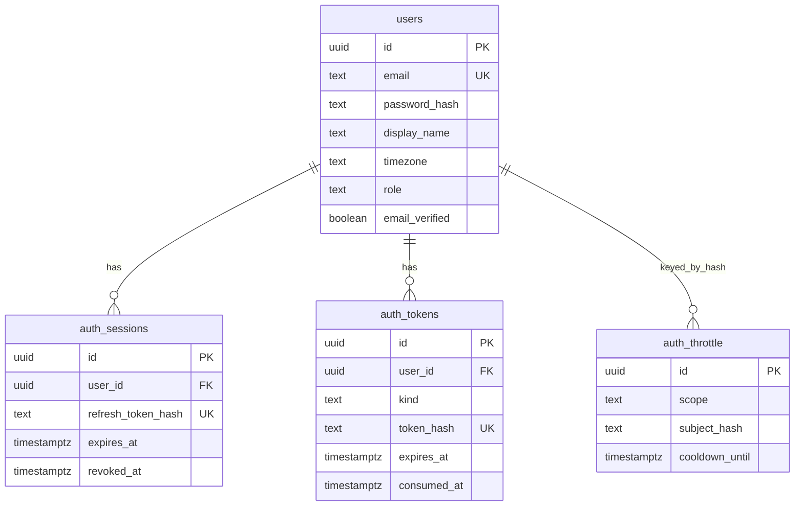
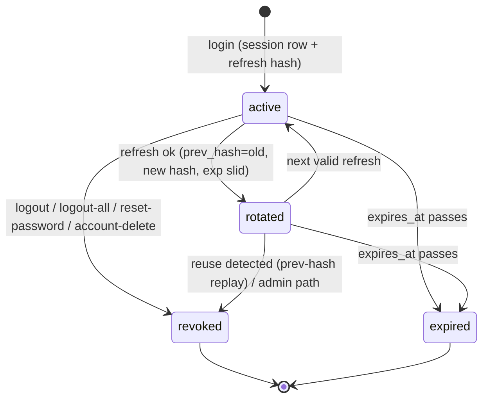
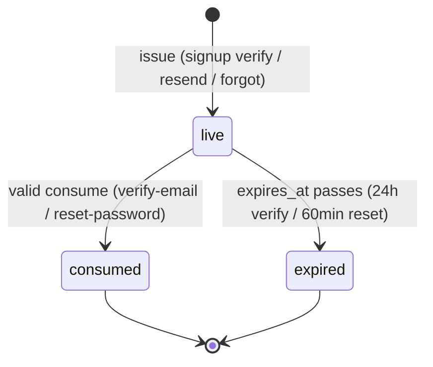

# LLD-MEDO-IDENTITY-001: Identity Service — implementation design

## 1. Document control header

Identity | backend-microservice | HLD-MEDO-IDENTITY-001@1.0 | approved

## 2. Design context and scope

### 2.1 Upstream HLD consumed

`HLD-MEDO-IDENTITY-001@1.0` (status: approved, `lld_readiness: pass`). Sections/blocks consumed by reference: §2 goals DG-ID-1…6 and non-goals; §4 boundary statement + invariants; §5 all eleven blocks (`webapi-auth`, `webapi-internal`, `rate-limit`, `account-core`, `session-core`, `throttle-core`, `directory-core`, `deletion-workflow`, `persistence`, `eventing`, `auth-cleanup`); §6 data architecture (entity inventory, `identity_db` ownership, retention); §7 external contracts (12 public + 1 internal REST rows + JWKS platform surface + 1 consumed internal contract); §8 events (5 published, none consumed) + workflows FIG-ID-04-1…4; §9 frontend surface (consumed by Frontend LLD, not designed here); §10 cross-cutting (authN/authZ summary, observability, resilience, rate-limit, error posture, sensitive data); §11 security (trust boundaries, token lifecycle, data exposure, abuse controls); §12 deployment/secrets; §13 scaling; §14 failure/recovery/idempotency; §15 jobs; §16 HD-ID-01…06; §17 traceability; §18 OQ register (OQ-HLD-ID-01 carried here).

### 2.2 Component place in system

The Identity Service is the `medo-identity` repository — one autonomous repo under GitHub owner `kiro-ai-bit` (`inherited:.scratch/medo-lld/issues/02-repo-shared-package-layout.md@2026-11-23`), built as the `identity` container in the shared Docker Compose stack on AWS EC2 `t3.micro` (`inherited:HLD-MEDO-IDENTITY-001@1.0#12.1`). It realizes the approved HLD's eleven blocks as modules inside the mandatory four-layer structure (`Infrastructure/`, `Core/`, `Application/`, `WebAPI/` + `planning/` + `tests/` — Architecture Standard lines 169–218). It does NOT design: Care Link/check-link mechanics (Care), Medicine/Catalog/Schedule/Dose (Medicine, Schedule & Dose), notification prefs/feed/delivery (Notification), points/theme (Gamification), gateway routing (Caddy), frontend screens/Dexie (Frontend LLD), or `@kiro-ai-bit/eventing` package internals (separate repo).

### 2.3 Implementation goals

- LG-ID-1: Every HLD §5 block maps to ≥1 module and every module to exactly one primary layer; layer edges obey WebAPI→Application→Core→Infrastructure direction. [`HLD-MEDO-IDENTITY-001@1.0#5`; Architecture Standard lines 356–366]
- LG-ID-2: Every §7.1 contract row (12 public + 1 internal + JWKS) and §7.2 consumed row (`GET /v1/care/patients/{id}/links`) has a route module + handler signature + request/response DTO schema + error codes, with contract field shapes authored once as zod schemas in `@kiro-ai-bit/contracts`. [`HLD-MEDO-IDENTITY-001@1.0#7`; `inherited:.scratch/medo-lld/issues/03-contract-type-sharing.md@2026-11-24`]
- LG-ID-3: `identity_db` schema specifies every owned entity (users, sessions, auth tokens, throttle state, outbox participation) with columns/types/constraints/indexes and ordered migrations. [`HLD-MEDO-IDENTITY-001@1.0#6`; `inherited:.scratch/medo-backend/issues/03-database-technology.md@2026-11-21`]
- LG-ID-4: All five published events have exact envelope+payload field tables, same-transaction outbox writes, and publisher-worker bindings; consumed set is explicitly none. [`HLD-MEDO-IDENTITY-001@1.0#8`; `inherited:.scratch/medo-backend/issues/07-message-broker-event-transport.md@2026-11-21`]
- LG-ID-5: Non-trivial behaviors (password KDF, login cooldown, refresh rotation/reuse, token single-use consume, forgot-password window, deletion orchestration, `auth-cleanup` tick) carry invariants + pseudocode sufficient for implementation without decisions. [`HLD-MEDO-IDENTITY-001@1.0#16` HD-ID-02…06; PRD FR-IDT-*]
- LG-ID-6: Test strategy maps every §8 invariant and every contract row to unit/integration/contract/e2e cases using locked tooling (Vitest + `app.inject()`; Playwright e2e golden-path). [`inherited:.scratch/medo-lld/issues/01-test-dev-tooling.md@2026-11-23`]

### 2.4 Implementation non-goals

- Implementation-task sequencing and breakdown → `tasks` stage (Architecture Standard line 334).
- Source code, migrations-as-code, manifests, config files → implementation artifacts (C-L3, §6.5).
- `kid` rollover runbook/compromise drill procedure beyond the config mechanism → ops documentation (OQ-HLD-ID-01 resolved to mechanism level by LD-ID-08; residual ops drill → OQ-LLD-ID-01, non-blocking).
- Notification email templates/content → Notification LLD.
- Peer-service directory-cache mechanics → each consumer's own LLD (Identity's obligation = emit `ProfileChanged`/`AccountDeleted` only — `inherited:ticket-09`).

### 2.5 Inherited decisions

- Node.js + TypeScript + Fastify + Drizzle ORM (`inherited:.scratch/medo-backend/issues/01-backend-runtime-framework.md@2026-11-20`).
- AWS EC2 `t3.micro` + Docker Compose; `.env` local / SSM Parameter Store prod; `$25` Budget alert (`inherited:…/02-deployment-model-hosting.md@2026-11-20`).
- Self-hosted Postgres container, six logical DBs w/ per-service users, `identity_db` + own DB user, `drizzle-kit` migrations (`inherited:…/03-database-technology.md@2026-11-21`).
- Caddy gateway pass-through, explicit public-route table, cookie `HttpOnly; Secure; SameSite=Lax; Path=/v1/auth` host-only on `api.simmaps.com` (`inherited:…/05-api-gateway-entry-point.md@2026-11-21`; `.scratch/medo-hld/issues/01-domain-selection.md@2026-11-22`).
- User JWTs = Identity asymmetric keypair + JWKS; claims `iss/aud/sub/role/sid/iat/exp(25m)/jti`; refresh = SHA-256 session rows + rotation + reuse-detection; internal authn = per-service asymmetric JWTs, 5-min `aud`-scoped (`inherited:…/06-auth-token-mechanics.md@2026-11-21`).
- Postgres outbox + polling; per-service outbox same-tx; `broker_db.events`; sequential in-order consumers; 5 attempts → `broker_db.dead_letters`; `@medo/eventing` shared package — renamed `@kiro-ai-bit/eventing` in `medo-shared` (`inherited:…/07-message-broker-event-transport.md@2026-11-21`; `inherited:.scratch/medo-lld/issues/02-repo-shared-package-layout.md@2026-11-23`).
- Pino JSON + `X-Request-Id`/`eventId`; `/metrics` RED + custom counters; `/health` public + `/ready` internal; Sentry free tier (`inherited:…/08-observability.md@2026-11-21`; `platform-observability.md@2026-11-21`).
- Per-service Fastify rate-limit plugin, in-memory sliding window; public 30/min/IP, auth'd writes 60/min/userId, auth'd reads 300/min/userId, internal exempt, 429 + `Retry-After` (`inherited:…/09-rate-limiting-caching.md@2026-11-21`).
- Notification prefs owned by Notification — Identity stores none (`inherited:…/10-notification-preferences-scope.md@2026-11-21`).
- Domain `simmaps.com`; deploy via `medo-infra` `deploy.sh` health-gate + rollback (`inherited:.scratch/medo-hld/issues/01-02 @2026-11-22/23`).
- Baselines: `platform-quality-baseline.md@2026-11-21`, `platform-observability.md@2026-11-21`, `scheduled-jobs.md@2026-11-21` — cited, deltas only.
- HLD `HD-ID-01…06` records — all `accepted`; this LLD realizes them (HD-ID-02/03/04/05/06 → LD-ID-02/03/06/08/10 respectively; HD-ID-01 → module map §3).
- Repo/tooling: `medo-identity` repo, `@kiro-ai-bit/*` packages exact-pinned + lockfile (`inherited:.scratch/medo-lld/issues/02@2026-11-23`); Vitest + `app.inject()` + contract tests (`inherited:.scratch/medo-lld/issues/01@2026-11-23`); `@kiro-ai-bit/contracts` zod schemas = single source for public-route DTOs (`inherited:.scratch/medo-lld/issues/03@2026-11-24`).

## 3. Repository structure and module map

### 3.1 Repository declaration (backend profile §4.1)

Repository: `medo-identity` (public, MIT) under GitHub owner `kiro-ai-bit`; consumes `@kiro-ai-bit/{eventing,rate-limit,contracts,eslint-config,tsconfig,test-utils}` from GitHub Packages, exact-pinned + committed lockfile (`inherited:.scratch/medo-lld/issues/02@2026-11-23`). Logical namespaces: `Medo.Identity.Infrastructure`, `Medo.Identity.Core`, `Medo.Identity.Application`, `Medo.Identity.WebAPI` — physical folder names stay generic per Architecture Standard lines 24–50. TypeScript import convention (LD-ID-01): path aliases per layer root (`@core/*`, `@application/*`, `@infrastructure/*`, `@webapi/*`) resolved by `@kiro-ai-bit/tsconfig`; cross-layer imports only in the allowed direction. `planning/` holds pointers to approved PRD/HLD/LLD copies per repo convention — cite, don't copy. Service bootstrap unit: `src/bootstrap.ts` → `buildApp()` (composition root, §4.1 below).

```
medo-identity/
├── Infrastructure/
│   ├── Persistence/          # drizzle schema + repositories + outbox writes
│   ├── Eventing/             # outbox publisher worker binding
│   └── Clients/              # Care links-check HTTP client
├── Core/
│   ├── Account/              # account rules: signup/verify/profile
│   ├── Session/              # session/token rules: login/refresh/logout/reset
│   ├── Throttle/             # cooldown + forgot-password window rules
│   └── Directory/            # directory DTO assembly + JWKS key-set assembly
├── Application/
│   ├── DeletionWorkflow/     # DELETE /v1/me orchestration
│   └── Jobs/                 # auth-cleanup tick
├── WebAPI/
│   ├── Auth/                 # public /v1/auth/* + /v1/me routes
│   ├── Internal/             # GET /v1/users/{id} route
│   ├── Platform/             # /health /ready /metrics /.well-known/jwks.json
│   ├── Middleware/           # authN guards, rate-limit registration, error handler
│   └── bootstrap.ts          # buildApp() composition root
├── planning/                 # pointers to approved planning docs
└── tests/
    ├── unit/
    ├── integration/
    ├── contract/
    └── e2e/
```

### 3.2 Module map

| Module ID | Responsibility | Physical path | Layer | HLD block | LD-ref |
|---|---|---|---|---|---|
| `webapi-auth-routes` | Public `/v1/auth/*` + `/v1/me` route registration + handlers | `WebAPI/Auth/` | WebAPI | `webapi-auth` | — |
| `webapi-internal-routes` | `GET /v1/users/{id}` route + service-JWT gate | `WebAPI/Internal/` | WebAPI | `webapi-internal` | — |
| `webapi-platform-routes` | `/health`, `/ready`, `/metrics`, `/.well-known/jwks.json` | `WebAPI/Platform/` | WebAPI | `webapi-auth` (platform surface) | — |
| `webapi-rate-limit` | Rate-limit plugin registration + route-class bindings | `WebAPI/Middleware/` | WebAPI | `rate-limit` | — |
| `webapi-authn` | User-JWT verify guard + service-JWT verify guard + error handler | `WebAPI/Middleware/` | WebAPI | `webapi-auth`, `webapi-internal` | — |
| `core-account` | Signup, email verify/resend, profile read/update rules | `Core/Account/` | Core | `account-core` | LD-ID-07 |
| `core-session` | Login issue, refresh rotation/reuse, logout(s), forgot/reset password rules | `Core/Session/` | Core | `session-core` | LD-ID-02, 06 |
| `core-throttle` | Login cooldown + forgot-password window evaluation | `Core/Throttle/` | Core | `throttle-core` | LD-ID-04 |
| `core-directory` | Directory DTO assembly + JWKS key-set publication | `Core/Directory/` | Core | `directory-core` | LD-ID-08 |
| `app-deletion-workflow` | Deletion orchestration: auth → Care links check → purge tx → `AccountDeleted` | `Application/DeletionWorkflow/` | Application | `deletion-workflow` | LD-ID-10 |
| `app-auth-cleanup` | Daily `04:30 UTC` purge of expired tokens/sessions/throttle rows | `Application/Jobs/` | Application | `auth-cleanup` | — |
| `infra-persistence` | Drizzle schema, repositories, outbox row writes for all 5 events | `Infrastructure/Persistence/` | Infrastructure | `persistence` | LD-ID-03, 05 |
| `infra-eventing` | `@kiro-ai-bit/eventing` ensure-DDL + publisher worker config | `Infrastructure/Eventing/` | Infrastructure | `eventing` | — |
| `infra-care-client` | `GET /v1/care/patients/{id}/links` client + service-JWT mint | `Infrastructure/Clients/` | Infrastructure | `deletion-workflow` (peer call) | — |
| `bootstrap` | Composition root: plugins, workers, jobs, routes registration order | `WebAPI/bootstrap.ts` | WebAPI | all blocks | — |

HLD block → module coverage: `webapi-auth`→webapi-auth-routes/webapi-platform-routes/webapi-rate-limit/webapi-authn; `webapi-internal`→webapi-internal-routes/webapi-authn; `account-core`→core-account; `session-core`→core-session; `throttle-core`→core-throttle; `directory-core`→core-directory; `deletion-workflow`→app-deletion-workflow + infra-care-client; `persistence`→infra-persistence; `eventing`→infra-eventing; `auth-cleanup`→app-auth-cleanup; `rate-limit`→webapi-rate-limit. Zero orphans both directions.

### 3.3 Bootstrap registration order (backend profile §4.1)

`buildApp()` registers in fixed order: (1) Pino logger + `X-Request-Id` hook; (2) error-handler plugin (single mapping point, §14); (3) rate-limit plugin (`@kiro-ai-bit/rate-limit`); (4) authN guards (user-JWT verify, service-JWT verify); (5) Zod/JSON-schema route registration per module; (6) `infra-eventing` ensure-DDL + start publisher worker; (7) `app-auth-cleanup` node-cron registration; (8) `/health` `/ready` `/metrics` platform routes. Failure at any step = fail-fast boot (env validation first — §13).

## 4. Module and unit detailed design

### 4.1 `webapi-auth-routes`: public auth + `/v1/me` routes

| Unit | Kind | Signature | Responsibility | Depends on | Realizes |
|---|---|---|---|---|---|
| `signupRoute` | function | `(app: FastifyInstance): Promise<void>` | Register `POST /v1/auth/signup` handler | `core-account`, `infra-persistence`, contracts | §6 `POST /v1/auth/signup` |
| `loginRoute` | function | `(app: FastifyInstance): Promise<void>` | Register `POST /v1/auth/login` handler | `core-session`, `core-throttle` | §6 `POST /v1/auth/login` |
| `refreshRoute` | function | `(app: FastifyInstance): Promise<void>` | Register `POST /v1/auth/refresh` handler | `core-session` | §6 `POST /v1/auth/refresh` |
| `logoutRoute` | function | `(app: FastifyInstance): Promise<void>` | Register `POST /v1/auth/logout` handler | `core-session` | §6 `POST /v1/auth/logout` |
| `logoutAllRoute` | function | `(app: FastifyInstance): Promise<void>` | Register `POST /v1/auth/logout-all` handler | `core-session` | §6 `POST /v1/auth/logout-all` |
| `forgotPasswordRoute` | function | `(app: FastifyInstance): Promise<void>` | Register `POST /v1/auth/forgot-password` handler | `core-session`, `core-throttle` | §6 `POST /v1/auth/forgot-password` |
| `resetPasswordRoute` | function | `(app: FastifyInstance): Promise<void>` | Register `POST /v1/auth/reset-password` handler | `core-session` | §6 `POST /v1/auth/reset-password` |
| `verifyEmailRoute` | function | `(app: FastifyInstance): Promise<void>` | Register `POST /v1/auth/verify-email` handler | `core-account` | §6 `POST /v1/auth/verify-email` |
| `resendVerificationRoute` | function | `(app: FastifyInstance): Promise<void>` | Register `POST /v1/auth/resend-verification` handler | `core-account` | §6 `POST /v1/auth/resend-verification` |
| `getMeRoute` | function | `(app: FastifyInstance): Promise<void>` | Register `GET /v1/me` handler | `core-account` | §6 `GET /v1/me` |
| `patchMeRoute` | function | `(app: FastifyInstance): Promise<void>` | Register `PATCH /v1/me` handler | `core-account` | §6 `PATCH /v1/me` |
| `deleteMeRoute` | function | `(app: FastifyInstance): Promise<void>` | Register `DELETE /v1/me` handler | `app-deletion-workflow` | §6 `DELETE /v1/me` |
| `setRefreshCookie` | function | `(reply: FastifyReply, rawToken: string, expiresAt: Date): void` | Emit `Set-Cookie` with locked attributes | — | FR-IDT-021 cookie contract |
| `clearRefreshCookie` | function | `(reply: FastifyReply): void` | Emit expired `Set-Cookie` clearing the refresh cookie | — | FR-IDT-018 |

Handlers are thin: parse DTO via `@kiro-ai-bit/contracts` zod schema bound at registration, call the named Application/Core unit, map result via §14 error registry. Route files contain no business rules.

### 4.2 `webapi-internal-routes`: directory route

| Unit | Kind | Signature | Responsibility | Depends on | Realizes |
|---|---|---|---|---|---|
| `getUserRoute` | function | `(app: FastifyInstance): Promise<void>` | Register `GET /v1/users/{id}` handler behind service-JWT guard | `core-directory`, `infra-persistence` | §6 `GET /v1/users/{id}` |

### 4.3 `webapi-platform-routes`: health/metrics/JWKS

| Unit | Kind | Signature | Responsibility | Depends on | Realizes |
|---|---|---|---|---|---|
| `healthRoute` | function | `(app: FastifyInstance): Promise<void>` | Liveness 200 | — | §6 `/health` |
| `readyRoute` | function | `(app: FastifyInstance, deps: { pingIdentityDb(): Promise<void>; pingBrokerDb(): Promise<void> }): Promise<void>` | Readiness: `identity_db` ping + `broker_db` ping → 200/503 | `infra-persistence`, `infra-eventing` | §6 `/ready` |
| `metricsRoute` | function | `(app: FastifyInstance): Promise<void>` | Prometheus text `/metrics`, service-JWT gated | metrics registry | §6 `/metrics` |
| `jwksRoute` | function | `(app: FastifyInstance, jwks: JsonWebKeySet): Promise<void>` | Serve `GET /.well-known/jwks.json` public key set | `core-directory` (key config) | §6 `/.well-known/jwks.json` |

### 4.4 `webapi-rate-limit`: rate-limit binding

| Unit | Kind | Signature | Responsibility | Depends on | Realizes |
|---|---|---|---|---|---|
| `registerRateLimit` | function | `(app: FastifyInstance): Promise<void>` | Register `@kiro-ai-bit/rate-limit` plugin with Identity route-class table (§12) | `@kiro-ai-bit/rate-limit` | HLD `rate-limit` block |

### 4.5 `webapi-authn`: authentication guards + error handler

| Unit | Kind | Signature | Responsibility | Depends on | Realizes |
|---|---|---|---|---|---|
| `verifyUserJwt` | function | `(token: string, deps: { publicKeys: JsonWebKeySet; issuer: string; audience: string }): Promise<UserJwtClaims>` | Verify user access JWT locally via config key set; returns claims `{sub, role, sid, iat, exp, jti, iss, aud}` or throws `AuthError` | `jose`, key config | HLD §10.1 user-JWT domain |
| `verifyServiceJwt` | function | `(token: string, deps: { peerPublicKeys: Record<string, JsonWebKeySet>; expectedAud: string }): Promise<ServiceJwtClaims>` | Verify caller service JWT: `iss=medo-<caller>` known peer, `aud=medo-identity`, `exp` valid | `jose`, service pubkey config | HLD §10.1 service-JWT domain; FR-IDT-031 |
| `userAuthGuard` | function | `(app: FastifyInstance): void` | Fastify `preHandler` attaching `request.user = UserJwtClaims` on session routes | `verifyUserJwt` | §6 session-route middleware |
| `serviceAuthGuard` | function | `(app: FastifyInstance): void` | Fastify `preHandler` attaching `request.serviceCaller` on internal routes | `verifyServiceJwt` | §6 internal-route middleware |
| `errorHandler` | function | `(app: FastifyInstance): void` | Single mapping point: thrown error class → status + `{error:{code,message,requestId}}` (§14) | — | §14 taxonomy |

### 4.6 `core-account`: account rules

| Unit | Kind | Signature | Responsibility | Depends on | Realizes |
|---|---|---|---|---|---|
| `signup` | function | `(cmd: SignupCommand, tx: DbTx): Promise<SignupResult>` | Validate role enum, normalize email, duplicate-check, hash password, insert user + verify token + 2 outbox rows | `argon2`, `core-directory` (email norm), repos | FR-IDT-001…005 |
| `verifyEmail` | function | `(token: string, tx: DbTx): Promise<void>` | Consume verify token atomically; set `emailVerified=true` | `core-throttle` (n/a), repos | FR-IDT-006/007 |
| `resendVerification` | function | `(email: string, tx: DbTx): Promise<void>` | Re-issue verify token + `EmailVerificationRequested` outbox row for registered account; identical response for unknown email | repos | FR-IDT-009 |
| `getOwnProfile` | function | `(userId: string): Promise<OwnProfileDto>` | Assemble `{displayName, timezone, role, email, emailVerified}` | repos | FR-IDT-027 |
| `updateOwnProfile` | function | `(userId: string, patch: ProfilePatch, tx: DbTx): Promise<ProfileChangedPayload>` | Apply allowed fields only (`displayName`, `timezone`); compute `changedFields[]`; write `ProfileChanged` outbox row same-tx | repos | FR-IDT-028/029 |
| `normalizeEmail` | function | `(email: string): string` | Trim + lowercase (LD-ID-07) | — | FR-IDT-001 input rule |
| `validateTimezone` | function | `(tz: string): boolean` | IANA timezone check via `Intl.supportedValuesOf('timeZone')` | — | FR-IDT-028 field rule |

### 4.7 `core-session`: session/token rules

| Unit | Kind | Signature | Responsibility | Depends on | Realizes |
|---|---|---|---|---|---|
| `login` | function | `(cmd: LoginCommand, tx: DbTx): Promise<LoginResult>` | Credential verify → emailVerified gate → issue session row + access JWT + raw refresh token | `argon2`, `jose`, `core-throttle`, repos | FR-IDT-008/010/011 |
| `rotateRefresh` | function | `(rawToken: string, tx: DbTx): Promise<RefreshResult>` | Hash lookup → rotation/reuse/expired branches → new session state + new access JWT + new raw refresh | `jose`, repos | FR-IDT-015…017 |
| `logout` | function | `(rawToken: string, tx: DbTx): Promise<void>` | Revoke the session row matching the presented refresh token | repos | FR-IDT-018 |
| `logoutAll` | function | `(userId: string, tx: DbTx): Promise<void>` | Revoke all session rows for account | repos | FR-IDT-019 |
| `forgotPassword` | function | `(email: string, tx: DbTx): Promise<void>` | Identical response always; for registered email: consume window check → reset token + throttle row + `PasswordResetRequested` outbox | repos, `core-throttle` | FR-IDT-022…024 |
| `resetPassword` | function | `(token: string, newPassword: string, tx: DbTx): Promise<void>` | Consume reset token → set new hash → revoke all sessions → outbox none | `argon2`, repos | FR-IDT-025/026 |
| `issueAccessToken` | function | `(claims: {sub: string; role: Role; sid: string}): Promise<string>` | Sign user JWT via `jose` — claims `iss/aud/sub/role/sid/iat/exp(25m)/jti`, `kid` from config | `jose` | FR-IDT-010, ticket-06 claims |
| `generateOpaqueToken` | function | `(): { raw: string; hash: string }` | `crypto.randomBytes(32)` base64url raw + SHA-256 hex hash (LD-ID-06) | `node:crypto` | HD-ID-03 |
| `hashToken` | function | `(raw: string): string` | SHA-256 hex of raw token | `node:crypto` | refresh/verify/reset storage |
| `verifyPassword` | function | `(plain: string, phc: string): Promise<boolean>` | `argon2.verify` wrapper | `argon2` | FR-IDT-003/011 |
| `hashPassword` | function | `(plain: string): Promise<string>` | `argon2.hash` with LD-ID-02 params | `argon2` | FR-IDT-003 |
| `needsRehash` | function | `(phc: string): boolean` | `argon2.needsRehash` vs configured params (LD-ID-02) | `argon2` | parameter-drift path |

### 4.8 `core-throttle`: throttle rules

| Unit | Kind | Signature | Responsibility | Depends on | Realizes |
|---|---|---|---|---|---|
| `checkLoginThrottle` | function | `(email: string, ip: string, tx: DbTx): Promise<ThrottleVerdict>` | Return `allow | cooldown` for email+IP pair per FR-IDT-013 window | `infra-persistence` (throttle repo) | FR-IDT-012/013 |
| `recordLoginFailure` | function | `(email: string, ip: string, tx: DbTx): Promise<void>` | Increment failure count; at 3rd set `cooldownUntil = now + 25min` | throttle repo | FR-IDT-013 |
| `resetLoginThrottle` | function | `(email: string, ip: string, tx: DbTx): Promise<void>` | Clear pair state on successful login | throttle repo | FR-IDT-014 |
| `checkForgotWindow` | function | `(email: string, tx: DbTx): Promise<boolean>` | True if <2 requests in trailing 1 h for email | throttle repo | FR-IDT-024 |
| `recordForgotRequest` | function | `(email: string, tx: DbTx): Promise<void>` | Append request timestamp for window accounting | throttle repo | FR-IDT-024 |

### 4.9 `core-directory`: directory + JWKS

| Unit | Kind | Signature | Responsibility | Depends on | Realizes |
|---|---|---|---|---|---|
| `getDirectoryEntry` | function | `(userId: string): Promise<DirectoryDto \| null>` | Load user → DTO `{id, displayName, role, email}` (LD-ID-09); null → 404 | repos | FR-IDT-030 |
| `buildJwks` | function | `(keyConfig: SigningKeyConfig): JsonWebKeySet` | Assemble public JWKS from configured key set incl. all rotation-overlap keys (LD-ID-08) | key config | FR-IDT-020, HD-ID-05 |

### 4.10 `app-deletion-workflow`: deletion orchestration

| Unit | Kind | Signature | Responsibility | Depends on | Realizes |
|---|---|---|---|---|---|
| `deleteAccount` | function | `(userId: string, role: Role, deps: { careLinks: CareLinksClient; txRunner: TxRunner }): Promise<DeleteResult>` | Orchestrate HD-ID-06 sequence: Patient → Care links check (fail-closed) → single tx purge + `AccountDeleted` outbox | `infra-care-client`, `infra-persistence` | FR-IDT-032…038, HD-ID-06 |

### 4.11 `app-auth-cleanup`: cleanup job

| Unit | Kind | Signature | Responsibility | Depends on | Realizes |
|---|---|---|---|---|---|
| `authCleanupTick` | function | `(deps: { repos: IdentityRepos; clock: Clock }): Promise<{ purgedTokens: number; purgedSessions: number; purgedThrottle: number }>` | One tick: delete expired/consumed `auth_tokens`, expired/revoked `auth_sessions`, expired `auth_throttle` rows | `infra-persistence` | §10 `auth-cleanup`, scheduled-jobs.md |
| `registerAuthCleanupJob` | function | `(scheduler: CronScheduler, tick: () => Promise<void>): void` | node-cron registration `0 30 4 * * *` UTC | `node-cron` | §10 job binding |

### 4.12 `infra-persistence`: schema + repositories + outbox writes

| Unit | Kind | Signature | Responsibility | Depends on | Realizes |
|---|---|---|---|---|---|
| `usersRepo` | repository | interface `UsersRepo` — see §5.1 signatures | UserAccount CRUD + lookup by email/id | drizzle | §5 `users` |
| `sessionsRepo` | repository | interface `SessionsRepo` | AuthSession CRUD, rotate, revoke-by-token/user, purge-expired | drizzle | §5 `auth_sessions` |
| `authTokensRepo` | repository | interface `AuthTokensRepo` | Verify/reset token issue/consume/purge (single-use atomic) | drizzle | §5 `auth_tokens` |
| `throttleRepo` | repository | interface `ThrottleRepo` | Throttle state get/upsert/expire per scope+subjectHash | drizzle | §5 `auth_throttle` |
| `outboxWriter` | repository | `appendOutbox(tx: DbTx, event: OutboxEventInput): Promise<void>` | Insert outbox row inside caller's tx for all 5 events | `@kiro-ai-bit/eventing` types | §7 published events |
| `txRunner` | function | `(fn: (tx: DbTx) => Promise<T>): Promise<T>` | Begin/commit/rollback wrapper over `identity_db` connection | drizzle | §9 tx boundaries |
| `db` | object | Drizzle client bound to `identity_db` DSN | Single DB access point for all repos | `drizzle-orm`, env | §13 config |

Repository interfaces (signatures, kind=interface):

- `UsersRepo`: `findByEmail(email: string): Promise<UserRow | null>`; `findById(id: string): Promise<UserRow | null>`; `insert(user: NewUserRow): Promise<UserRow>`; `updateProfile(id: string, patch: {displayName?: string; timezone?: string}): Promise<UserRow>`; `setEmailVerified(id: string): Promise<void>`; `setPasswordHash(id: string, hash: string): Promise<void>`; `deleteWithDependents(id: string): Promise<void>` (deletes user + sessions + tokens + throttle rows in one tx).
- `SessionsRepo`: `insert(session: NewSessionRow): Promise<SessionRow>`; `findByRefreshHash(hash: string): Promise<SessionRow | null>`; `findByPrevRefreshHash(hash: string): Promise<SessionRow | null>`; `rotate(id: string, next: {refreshTokenHash: string; prevRefreshTokenHash: string; expiresAt: Date; lastUsedAt: Date}): Promise<SessionRow>`; `revoke(id: string): Promise<void>`; `revokeAllForUser(userId: string): Promise<number>`; `deleteExpiredOrRevoked(before: Date): Promise<number>`.
- `AuthTokensRepo`: `insert(token: NewAuthTokenRow): Promise<AuthTokenRow>`; `consumeByHash(hash: string, kind: AuthTokenKind, now: Date): Promise<AuthTokenRow | null>` (atomic `UPDATE … WHERE consumed_at IS NULL AND expires_at > now RETURNING`); `deleteExpiredOrConsumed(before: Date): Promise<number>`.
- `ThrottleRepo`: `get(scope: ThrottleScope, subjectHash: string): Promise<ThrottleRow | null>`; `upsert(scope: ThrottleScope, subjectHash: string, patch: Partial<ThrottleRow>): Promise<ThrottleRow>`; `deleteExpired(before: Date): Promise<number>`.

### 4.13 `infra-eventing`: publisher binding

| Unit | Kind | Signature | Responsibility | Depends on | Realizes |
|---|---|---|---|---|---|
| `ensureEventingSchema` | function | `(db: DbClient): Promise<void>` | Call `@kiro-ai-bit/eventing` ensure-DDL for own outbox table at boot | `@kiro-ai-bit/eventing` | §7 bindings |
| `startPublisherWorker` | function | `(deps: { db: DbClient; brokerDsn: string; logger: Logger }): Promise<PublisherHandle>` | Start outbox→`broker_db.events` publisher, 5 s poll, batch drain, delete-after-publish | `@kiro-ai-bit/eventing` | §10 worker loops |

### 4.14 `infra-care-client`: Care links check

| Unit | Kind | Signature | Responsibility | Depends on | Realizes |
|---|---|---|---|---|---|
| `careLinksClient` | class | `class CareLinksClient { getPatientLinks(patientId: string): Promise<CareLinkRef[]> }` | Call `GET /v1/care/patients/{id}/links` with minted service JWT (`iss=medo-identity`, `aud=medo-care`, 5-min) | `jose`, `node-fetch`/undici | §11 outbound contract |
| `mintServiceToken` | function | `(claims: {iss: string; aud: string; sub: string}): Promise<string>` | Sign per-service JWT via `jose` with Identity private key from config | `jose` | ticket-06 internal authn |

Rationale per group: WebAPI modules are thin transport shells (schema validation + guards + error mapping) so Core stays HTTP-free; Core split mirrors the HLD aggregate boundaries (account vs session vs throttle vs directory) so each rule set has one owner; Application holds only cross-aggregate orchestration (deletion) and the scheduled tick; Infrastructure owns all drizzle/eventing/HTTP-client mechanics. One module = one folder; no module spans layers (cross-layer justified inline: `infra-care-client` is called only by `app-deletion-workflow`).

FIG-ID-01: module/component diagram (C4 level-3 analogue)

```mermaid
flowchart TB
    subgraph WebAPI["WebAPI layer"]
        WA[webapi-auth-routes<br/>/v1/auth/* + /v1/me]
        WI[webapi-internal-routes<br/>/v1/users/{id}]
        WP[webapi-platform-routes<br/>/health /ready /metrics /jwks]
        WR[webapi-rate-limit]
        WN[webapi-authn<br/>JWT guards + error handler]
        BS[bootstrap buildApp]
    end
    subgraph Application["Application layer"]
        DW[app-deletion-workflow]
        AJ[app-auth-cleanup]
    end
    subgraph Core["Core layer"]
        CA[core-account]
        CS[core-session]
        CT[core-throttle]
        CD[core-directory]
    end
    subgraph Infrastructure["Infrastructure layer"]
        IP[infra-persistence<br/>repos + outbox writes]
        IE[infra-eventing<br/>publisher worker]
        IC[infra-care-client]
    end
    WA --> CA & CS & CT & DW
    WI --> CD
    WP --> CD
    DW --> IC & IP
    AJ --> IP
    CA & CS & CT & CD --> IP
    IE --> IP
    BS --> WA & WI & WP & WR & WN & IE & AJ
```

## 5. Data model and persistence design

Owned store: `identity_db` only (`inherited:ticket-03`). `broker_db` tables (`events`, `dead_letters`) are owned by `@kiro-ai-bit/eventing` — cited, never redefined (LD-ID-11). Drizzle schema organization: one schema file per aggregate family under `Infrastructure/Persistence/schema/` — `users.ts`, `sessions.ts`, `auth_tokens.ts`, `throttle.ts`, `outbox.ts`; table names `snake_case` plural; domain→PG mapping: `uuid` PKs (`gen_random_uuid()` default), `text` for enums w/ CHECK constraints, `timestamptz` for all times, `jsonb` only where noted, `boolean` flags. Migration naming: `NNNN-<slug>` sequential via `drizzle-kit generate` (ticket 03).

### 5.1 `users`

The UserAccount aggregate root — credentials, role, profile fields, verification flag (PRD §9.1; HLD §6.1). Owning unit: `infra-persistence/usersRepo`.

| Column | Type | Nullable | Default | Constraints | Notes |
|---|---|---|---|---|---|
| `id` | `uuid` | no | `gen_random_uuid()` | PK | Identity `userId` used platform-wide |
| `email` | `text` | no | — | UNIQUE, CHECK `email = lower(email)` | Login identifier; PII; normalized per LD-ID-07 |
| `password_hash` | `text` | no | — | — | Argon2id PHC string (LD-ID-02); credentials material — never in DTO/log/event |
| `display_name` | `text` | no | — | CHECK `char_length(display_name) BETWEEN 1 AND 80` | PII-lite; shown to linked caregivers |
| `timezone` | `text` | no | `'UTC'` | CHECK `char_length(timezone) <= 64` | IANA name validated app-level (LD-ID-07) |
| `role` | `text` | no | — | CHECK `role IN ('Patient','Caregiver')` | Enum verbatim per catalog |
| `email_verified` | `boolean` | no | `false` | — | Verification gate (FR-IDT-008) |
| `created_at` | `timestamptz` | no | `now()` | — | |
| `updated_at` | `timestamptz` | no | `now()` | — | Bumped on profile/password/verify writes |

Constraints: PK `users_pkey`; UNIQUE `users_email_key` (natural idempotency for signup duplicate → conflict); CHECKs above. Indexes: none beyond PK/UNIQUE — every query path (`findByEmail`, `findById`) is served by PK or the unique email index; no speculative indexes.

Relationships: 1—* to `auth_sessions`, `auth_tokens`, `auth_throttle` (all `ON DELETE CASCADE` — account purge removes dependents atomically, FR-IDT-036).

### 5.2 `auth_sessions`

Per-device session row backing refresh-token rotation (PRD §9.1; ticket-06 session store). Owning unit: `infra-persistence/sessionsRepo`.

| Column | Type | Nullable | Default | Constraints | Notes |
|---|---|---|---|---|---|
| `id` | `uuid` | no | `gen_random_uuid()` | PK | Becomes JWT `sid` claim |
| `user_id` | `uuid` | no | — | FK → `users.id` ON DELETE CASCADE | |
| `refresh_token_hash` | `text` | no | — | UNIQUE | SHA-256 hex of raw refresh token; raw never stored (DG-ID-5) |
| `prev_refresh_token_hash` | `text` | yes | `NULL` | — | SHA-256 hex of immediately-previous refresh hash; set on rotation, cleared on revoke/purge; replay detector (LD-ID-06, FR-IDT-016) |
| `device_label` | `text` | yes | `NULL` | CHECK `char_length(device_label) <= 120` | Optional human hint parsed from User-Agent at login (LD-ID-05); not authz data |
| `created_at` | `timestamptz` | no | `now()` | — | |
| `last_used_at` | `timestamptz` | no | `now()` | — | Sliding-renewal anchor |
| `expires_at` | `timestamptz` | no | — | — | ~30-day sliding expiry per PRD |
| `revoked_at` | `timestamptz` | yes | `NULL` | — | Set by logout/logout-all/reset/delete; non-null = dead |

Constraints: PK; UNIQUE `auth_sessions_refresh_token_hash_key`; FK cascade. Indexes: `idx_auth_sessions_user_id` btree(`user_id`) — serves `revokeAllForUser` + deletion purge; `idx_auth_sessions_prev_hash` btree(`prev_refresh_token_hash`) WHERE `prev_refresh_token_hash IS NOT NULL` — serves reuse-detection lookup (§8.4); `idx_auth_sessions_expiry` btree(`expires_at`) WHERE `revoked_at IS NULL` — serves `deleteExpiredOrRevoked` sweep and refresh validity check ordering.

Relationships: *—1 to `users`; no children.

### 5.3 `auth_tokens`

Single-use verify/reset tokens, opaque + hashed (HD-ID-03; LD-ID-03 unified table). Owning unit: `infra-persistence/authTokensRepo`.

| Column | Type | Nullable | Default | Constraints | Notes |
|---|---|---|---|---|---|
| `id` | `uuid` | no | `gen_random_uuid()` | PK | Internal row id only — never in links |
| `user_id` | `uuid` | no | — | FK → `users.id` ON DELETE CASCADE | |
| `kind` | `text` | no | — | CHECK `kind IN ('email-verify','password-reset')` | Enum verbatim |
| `token_hash` | `text` | no | — | UNIQUE | SHA-256 hex of raw token; raw only inside event link |
| `expires_at` | `timestamptz` | no | — | — | 24 h verify / 60 min reset per PRD §9.4 |
| `consumed_at` | `timestamptz` | yes | `NULL` | — | Atomic consume marker (single-use) |
| `created_at` | `timestamptz` | no | `now()` | — | |

Constraints: PK; UNIQUE `auth_tokens_token_hash_key`; FK cascade; CHECK kind. Indexes: `idx_auth_tokens_user_kind` btree(`user_id`,`kind`) — serves resend-verification/forgot-password "latest live token" lookup and per-user purge; `idx_auth_tokens_expiry` btree(`expires_at`) — serves `deleteExpiredOrConsumed` sweep.

Relationships: *—1 to `users`; supersedes-per-kind is app-level (new issuance does not auto-invalidate older live tokens of same kind — see §7; old tokens still work until consumed/expired, matching PRD single-use semantics).

### 5.4 `auth_throttle`

DB-backed throttle/cooldown state (HD-ID-02; LD-ID-04 unified scope table). Owning unit: `infra-persistence/throttleRepo` + `core-throttle`.

| Column | Type | Nullable | Default | Constraints | Notes |
|---|---|---|---|---|---|
| `id` | `uuid` | no | `gen_random_uuid()` | PK | |
| `scope` | `text` | no | — | CHECK `scope IN ('login','forgot-password')` | Which business rule the row serves |
| `subject_hash` | `text` | no | — | — | SHA-256 hex of scope material: login = `email\n ip`; forgot = `email` (LD-ID-04); raw PII never stored |
| `window_started_at` | `timestamptz` | no | `now()` | — | Start of current counting window |
| `failure_count` | `integer` | no | `0` | CHECK `failure_count >= 0` | login scope: consecutive failures |
| `request_count` | `integer` | no | `0` | CHECK `request_count >= 0` | forgot scope: requests in trailing 1 h |
| `request_times` | `jsonb` | no | `'[]'` | — | forgot scope: ISO timestamps array, pruned to trailing 1 h (max ~2 entries meaningful; bounded) |
| `cooldown_until` | `timestamptz` | yes | `NULL` | — | login scope: rejection window end (3rd failure → +25 min) |
| `updated_at` | `timestamptz` | no | `now()` | — | |

Constraints: UNIQUE `auth_throttle_scope_subject_key` on (`scope`,`subject_hash`) — upsert target, natural idempotency for concurrent login attempts (last-writer-wins on counters is acceptable: worst case = one extra allowed attempt inside window, bounded by public rate limit). Indexes: `idx_auth_throttle_expiry` btree(`cooldown_until`) WHERE `cooldown_until IS NOT NULL` — serves cooldown check + expired-row purge.

PII note: `subject_hash` is keyed hash — email/IP not stored raw (stricter than PRD minimum; satisfies NFR-IDT-05).

### 5.5 `outbox` (participation — columns owned by `@kiro-ai-bit/eventing`)

The service's transactional outbox table lives in `identity_db`, created by `@kiro-ai-bit/eventing` ensure-DDL at boot (`inherited:ticket-07`; `infra-eventing/ensureEventingSchema`). Column shape is the package contract — cited, not redefined (LD-ID-11). This LLD binds only: one row per published event inside the triggering write tx (§9); payload = envelope `{eventId, occurredAt}` + minimal-change payload per §7; publisher deletes row after successful `broker_db.events` insert.

Published-event → outbox participation: `UserRegistered`, `EmailVerificationRequested`, `PasswordResetRequested`, `ProfileChanged`, `AccountDeleted` — all five via `outboxWriter.appendOutbox` inside the same tx as their domain write (§9 table).

### 5.6 Migration & seed plan

Ordered `drizzle-kit generate` migrations (deploy-time per ticket 03; outbox ensure-DDL runs at startup, not a migration):

1. `0001-users` — create `users` (all constraints/indexes).
2. `0002-auth-sessions` — create `auth_sessions` + FK + indexes.
3. `0003-auth-tokens` — create `auth_tokens` + FK + indexes.
4. `0004-auth-throttle` — create `auth_throttle` + unique + index.
5. Seed data: **none** — no HLD/PRD seed requirement; role enum enforced by CHECK; defaults are code-level (timezone `'UTC'`, `email_verified false`).

Concurrency machinery explicit: `users.email` UNIQUE (signup dedupe), `auth_sessions.refresh_token_hash` UNIQUE + `revoked_at` (rotation/reuse), `auth_tokens.token_hash` UNIQUE + `consumed_at` atomic consume, `auth_throttle` UNIQUE(scope,subject_hash) upsert, outbox `eventId` unique (package-owned).

FIG-ID-02: entity relationship sketch



## 6. API endpoint realization

Route-binding rule (backend profile §4.3): every route registers with schema-first validation — `@kiro-ai-bit/contracts` zod DTO schema bound via `fastify-type-provider-zod` at WebAPI; Core-level invariants enforced in Core units. Fixed middleware order per route group: `request-id → rate-limit → authN (userAuthGuard | serviceAuthGuard | none) → DTO validation → handler → errorHandler`. DTO↔domain mapping: boundary types are the contracts-package DTOs; `infra-persistence` rows map to DTOs inside Core units (`UserRow→OwnProfileDto`, `UserRow→DirectoryDto`); no domain row crosses WebAPI. Rate-limit classes and authZ bindings cite HLD §7.1 rows verbatim — never re-decided.

Error envelope (all endpoints): `{ "error": { "code": <code>, "message": <string>, "requestId": <string> } }` — LD-ID-12; codes per §14 registry.

### POST /v1/auth/signup

`webapi-auth-routes/signupRoute`; middleware: request-id → rate-limit(public) → DTO validation → handler. Authz: public. Idempotency: natural — duplicate email UNIQUE → 409.

Request (body):

| Field | Type | Req | Constraints/Default | Notes |
|---|---|---|---|---|
| `name` | string | yes | 1–80 chars after trim | maps to `display_name` |
| `email` | string | yes | valid email, ≤254 chars | normalized lowercase (LD-ID-07) |
| `password` | string | yes | 8–128 chars | never stored/logged |
| `role` | enum | yes | `'Patient' \| 'Caregiver'` | verbatim catalog |

Response (201):

| Field | Type | Req | Constraints/Default | Notes |
|---|---|---|---|---|
| `userId` | uuid | yes | — | new account id |
| `email` | string | yes | normalized | echo of stored email |
| `role` | enum | yes | — | assigned role |

Errors: `VALIDATION_FAILED` 400 (schema), `CONFLICT` 409 (duplicate email), `RATE_LIMITED` 429, `INTERNAL` 500. Side effects same-tx: user row + `email-verify` auth_token + outbox `UserRegistered` + `EmailVerificationRequested` (verifyLink = `${APP_BASE_URL}/verify-email?token=<raw>` — LD-ID-13).

### POST /v1/auth/login

`webapi-auth-routes/loginRoute`; middleware: request-id → rate-limit(public) → DTO → handler. Authz: public + business cooldown. Client IP read from `request.ip` (Caddy-forwarded).

Request (body):

| Field | Type | Req | Constraints/Default | Notes |
|---|---|---|---|---|
| `email` | string | yes | valid email | normalized |
| `password` | string | yes | 1–128 chars | |

Response (200):

| Field | Type | Req | Constraints/Default | Notes |
|---|---|---|---|---|
| `userId` | uuid | yes | — | |
| `accessToken` | string | yes | JWT, 25-min exp | `Authorization: Bearer` |
| `expiresAt` | string (ISO-8601) | yes | access-token expiry | |

Side effects: `Set-Cookie: medo_rt=<rawRefresh>; HttpOnly; Secure; SameSite=Lax; Path=/v1/auth; Max-Age=2592000` (LD-ID-06 cookie name; attributes verbatim ticket-05). Creates `auth_sessions` row. Errors: `UNAUTHORIZED` 401 (uniform for unknown-email/wrong-password — FR-IDT-011, no enumeration signal), `EMAIL_NOT_VERIFIED` 403 (FR-IDT-008 — distinct, contract-defined), `RATE_LIMITED` 429 + `Retry-After`, `VALIDATION_FAILED` 400. Cooldown active → `RATE_LIMITED` 429.

### POST /v1/auth/refresh

`webapi-auth-routes/refreshRoute`; middleware: request-id → rate-limit(public) → reads refresh cookie → handler. Authz: refresh cookie possession (cookie IS the credential; no Bearer required).

Request (body): none. Cookie `medo_rt` required — missing → `UNAUTHORIZED` 401.

Response (200): same shape as login (`userId`, `accessToken`, `expiresAt`) + rotated `Set-Cookie` with new raw refresh token and slid `Max-Age`.

Errors: `UNAUTHORIZED` 401 (expired/unknown/malformed token), `RATE_LIMITED` 429. Reuse detection: presented hash matches a session whose `refresh_token_hash` was rotated away or `revoked_at` set → revoke that session, return 401 (FR-IDT-016). Never-issued/malformed → 401 without touching other sessions.

### POST /v1/auth/logout

`webapi-auth-routes/logoutRoute`; middleware: request-id → rate-limit(auth-write) → userAuthGuard → handler. Authz: session.

Request (body): none. Uses `medo_rt` cookie → session revoke (the access JWT `sid` identifies session when cookie absent? — rule LD-ID-14: logout authenticates via refresh cookie; if cookie missing but valid Bearer with `sid`, revoke that `sid` session).

Response (204): empty body + `Set-Cookie` clearing `medo_rt`.

Errors: `UNAUTHORIZED` 401, `RATE_LIMITED` 429. Idempotent: repeat logout on dead session → 204 (natural no-op).

### POST /v1/auth/logout-all

`webapi-auth-routes/logoutAllRoute`; middleware same as logout. Authz: session (caller `sub`).

Request (body): none.

Response (204): empty + clear cookie. Revoke every `auth_sessions` row for `sub`.

Errors: `UNAUTHORIZED` 401, `RATE_LIMITED` 429. Idempotent.

### POST /v1/auth/forgot-password

`webapi-auth-routes/forgotPasswordRoute`; middleware: request-id → rate-limit(public) → DTO → handler. Authz: public + 2/hr per email business rule.

Request (body):

| Field | Type | Req | Constraints/Default | Notes |
|---|---|---|---|---|
| `email` | string | yes | valid email | normalized |

Response (202 — identical for known/unknown email, FR-IDT-022):

| Field | Type | Req | Constraints/Default | Notes |
|---|---|---|---|---|
| `accepted` | boolean | yes | always `true` | no existence signal |

For registered email inside window: create `password-reset` auth_token (60-min TTL) + throttle `request_times` append + outbox `PasswordResetRequested` `{userId,email,resetLink}` same tx (resetLink = `${APP_BASE_URL}/reset-password?token=<raw>` — LD-ID-13). Over 2/hr → identical 202 response, no token/event (window rejection is silent per FR-IDT-022/024). Errors: `VALIDATION_FAILED` 400, `RATE_LIMITED` 429 (public class only).

### POST /v1/auth/reset-password

`webapi-auth-routes/resetPasswordRoute`; middleware: request-id → rate-limit(public) → DTO → handler. Authz: reset token = the authorization (no session).

Request (body):

| Field | Type | Req | Constraints/Default | Notes |
|---|---|---|---|---|
| `token` | string | yes | opaque raw token | single-use |
| `password` | string | yes | 8–128 chars | |

Response (204): empty.

Single tx: consume token atomically → `setPasswordHash` → `revokeAllForUser` sessions → `updated_at` bump. Errors: `UNAUTHORIZED` 401 (expired/malformed/used token — uniform, FR-IDT-026), `VALIDATION_FAILED` 400, `RATE_LIMITED` 429.

### POST /v1/auth/verify-email

`webapi-auth-routes/verifyEmailRoute`; middleware: request-id → rate-limit(public) → DTO → handler. Authz: verify token = authorization.

Request (body):

| Field | Type | Req | Constraints/Default | Notes |
|---|---|---|---|---|
| `token` | string | yes | opaque raw token | single-use |

Response (204): empty. Single tx: atomic consume → `email_verified=true` + `updated_at` bump.

Errors: `UNAUTHORIZED` 401 (expired/malformed/used — FR-IDT-007), `VALIDATION_FAILED` 400, `RATE_LIMITED` 429.

### POST /v1/auth/resend-verification

`webapi-auth-routes/resendVerificationRoute`; middleware: request-id → rate-limit(public) → DTO → handler. Authz: public + rate-limited.

Request (body):

| Field | Type | Req | Constraints/Default | Notes |
|---|---|---|---|---|
| `email` | string | yes | valid email | normalized |

Response (202): `{ "accepted": true }` — identical for unknown email (enumeration-safe, mirrors forgot-password posture).

Registered+unverified: new `email-verify` token (24-h TTL, fresh row — older live tokens remain valid until consumed/expired per §5.3 note) + outbox `EmailVerificationRequested` same tx. Already-verified: identical 202, no-op. Errors: `VALIDATION_FAILED` 400, `RATE_LIMITED` 429.

### GET /v1/me

`webapi-auth-routes/getMeRoute`; middleware: request-id → rate-limit(auth-read) → userAuthGuard → handler. Authz: session (own profile only — `sub` from JWT, no userId param accepted).

Request: none (path none, query none, body none).

Response (200):

| Field | Type | Req | Constraints/Default | Notes |
|---|---|---|---|---|
| `displayName` | string | yes | — | |
| `timezone` | string | yes | IANA | |
| `role` | enum | yes | `'Patient' \| 'Caregiver'` | |
| `email` | string | yes | — | |
| `emailVerified` | boolean | yes | — | resolves PRD OQ-IDT-04 |

Errors: `UNAUTHORIZED` 401, `RATE_LIMITED` 429, `INTERNAL` 500. Read-only — no tx.

### PATCH /v1/me

`webapi-auth-routes/patchMeRoute`; middleware: request-id → rate-limit(auth-write) → userAuthGuard → DTO → handler. Authz: session own profile.

Request (body):

| Field | Type | Req | Constraints/Default | Notes |
|---|---|---|---|---|
| `displayName` | string | no | 1–80 chars trimmed | mutable |
| `timezone` | string | no | valid IANA | mutable |

`role`/`email` absent from schema — any supplied keys rejected by strict schema (`VALIDATION_FAILED` 400, FR-IDT-028). At least one mutable field required → else 400.

Response (200): same shape as `GET /v1/me` (updated profile).

Single tx: `updateProfile` + outbox `ProfileChanged` `{userId, changedFields[]}` — `changedFields` = sorted list of actually-changed field names among `{displayName, timezone}` (empty → no event? — rule: PATCH with zero effective changes still commits row update but emits event only when `changedFields` non-empty; LD-ID-15). Errors: `UNAUTHORIZED` 401, `VALIDATION_FAILED` 400, `RATE_LIMITED` 429.

### DELETE /v1/me

`webapi-auth-routes/deleteMeRoute` → `app-deletion-workflow/deleteAccount`; middleware: request-id → rate-limit(auth-write) → userAuthGuard → handler. Authz: session own account.

Request: none.

Response (204): empty + clear cookie. Orchestrates §9 deletion tx; repeat/unknown → `NOT_FOUND` 404 (FR-IDT-038).

Errors: `CONFLICT` 409 (Patient with ≥1 active Care Link — FR-IDT-033), `DEPENDENCY_UNAVAILABLE` 503 (Care check failed — fail-closed FR-IDT-035), `NOT_FOUND` 404, `UNAUTHORIZED` 401, `RATE_LIMITED` 429.

### GET /v1/users/{id} (internal)

`webapi-internal-routes/getUserRoute`; middleware: request-id → rate-limit(internal-exempt) → serviceAuthGuard(`aud=medo-identity`) → handler. Authz: service JWT only — user JWT/anonymous → 401/403 (FR-IDT-031).

Path param: `id` uuid required.

Response (200):

| Field | Type | Req | Constraints/Default | Notes |
|---|---|---|---|---|
| `id` | uuid | yes | — | |
| `displayName` | string | yes | — | |
| `role` | enum | yes | — | |
| `email` | string | yes | — | LD-ID-09: always included (catalog `email?` = may-be-absent, not must) |

Errors: `UNAUTHORIZED` 401, `FORBIDDEN` 403 (wrong `aud`), `NOT_FOUND` 404 (unknown/deleted user), `VALIDATION_FAILED` 400 (bad uuid). No caching inside Identity — caller-side 60 s cache is consumer obligation (`inherited:ticket-09`).

### GET /.well-known/jwks.json (platform surface)

`webapi-platform-routes/jwksRoute`; middleware: request-id → rate-limit(public) → handler. Authz: none — public keys.

Response (200): JWKS JSON `{ "keys": [ {kty, use, kid, alg, n, e} … ] }` assembled by `core-directory/buildJwks` from configured public key set — includes ALL keys in overlap window (LD-ID-08). Cache headers: `Cache-Control: public, max-age=300` (verifiers may cache; bounded by 25-min token TTL + overlap rule). Errors: `RATE_LIMITED` 429, `INTERNAL` 500.

### GET /health · GET /ready · GET /metrics (platform surface)

- `/health` — public, request-id only; 200 `{ "status": "ok" }` always when process up.
- `/ready` — internal (service-JWT gated, `aud=medo-identity`); pings `identity_db` (`SELECT 1`) + `broker_db` (`SELECT 1` on events table); 200 `{ "status": "ready", "deps": {"identity_db":"ok","broker_db":"ok"} }` or 503 with failing dep named.
- `/metrics` — internal (service-JWT gated); Prometheus text exposition: RED per route + Identity counters §12.

### Backend profile §4.3 bindings

- Fastify schema-first: zod schemas from `@kiro-ai-bit/contracts` for all 13 contract routes; platform routes use inline JSON schema.
- Validation split: transport shape (types/required/format) = schema-level zod; domain invariants (duplicate email, token validity windows, cooldown arithmetic, role enum semantics) = Core-level (§8 algorithms).
- Error-handler unit: `webapi-authn/errorHandler` sole mapping point (§14).
- Idempotency mechanisms are concrete per route in §9 (natural uniqueness / atomic consume / rotation mark / identical response).

## 7. Event realization

### Published events

All five produced inside the triggering write transaction via `outboxWriter.appendOutbox`; envelope `{eventId, occurredAt}` added by `@kiro-ai-bit/eventing` (package-owned). Payload field tables — verbatim per `service-catalog.md#event-catalog@2026-11-22` minimal-change rule:

| Event | Payload fields | Producing unit/tx | Ordering |
|---|---|---|---|
| `UserRegistered` | `userId: uuid (req)`, `role: 'Patient'\|'Caregiver' (req)` | `core-account/signup` inside signup tx (§9) | none — consumers tolerate any order |
| `EmailVerificationRequested` | `userId: uuid (req)`, `email: string (req)`, `verifyLink: string (req)` | `core-account/signup`, `core-account/resendVerification` inside their txs | none |
| `PasswordResetRequested` | `userId: uuid (req)`, `email: string (req)`, `resetLink: string (req)` | `core-session/forgotPassword` inside its tx | none |
| `ProfileChanged` | `userId: uuid (req)`, `changedFields: string[] (req)` — subset of `{displayName, timezone}` | `core-account/updateOwnProfile` inside PATCH tx | none |
| `AccountDeleted` | `userId: uuid (req)` | `app-deletion-workflow/deleteAccount` inside deletion tx | none |

`verifyLink`/`resetLink` values: `${APP_BASE_URL}/verify-email?token=<rawToken>` and `${APP_BASE_URL}/reset-password?token=<rawToken>` (LD-ID-13 — frontend landing paths confirmed by Care/HLD convention; frontend LLD owns the pages). Raw token appears ONLY in these two event payloads — never in logs/metrics/other events (§10.6 HLD).

### Consumed events

None — explicit statement per `service-catalog.md#identity-service@2026-11-22` ("Consumes: none"). Identity runs no consumer worker.

### Explicit none-statements

- Consumes no events; publishes exactly the five catalog events — zero additions.
- No scheduled publication; every event is request-transaction driven.
- Frontend consumes zero events (verified Map 6 ticket 03) — "not an event participant" applies to `LLD-MEDO-FRONTEND-001`, cited here for completeness.

### @kiro-ai-bit/eventing bindings

| Capability | API surface used (signature-level) | Init point | Config keys |
|---|---|---|---|
| Outbox ensure-DDL | `ensureSchema(db: DbClient): Promise<void>` (package export — verify exact name at implementation; assumption §18.2) | `bootstrap` step 6 via `infra-eventing/ensureEventingSchema` | `DATABASE_URL` |
| Publisher worker | `createPublisherWorker(opts: {db, brokerDsn, batchSize?, pollIntervalMs?}): Promise<PublisherHandle>` — poll 5 s per ticket-07; batch drain own outbox in `id` order; delete-after-publish | `bootstrap` step 6 via `infra-eventing/startPublisherWorker` | `BROKER_DATABASE_URL` |
| Envelope/zod schemas | `EventEnvelope`, per-event zod schema types for the 5 events (authored once — event types stay in `@kiro-ai-bit/eventing`, ticket 03) | compile-time imports in `infra-persistence/outboxWriter` | — |
| Dead letters | none owned — `broker_db.dead_letters` written by package retry policy (5 attempts); purge owned by Notification `broker-watchdog` | n/a | — |

Ordering guarantees offered: none beyond per-outbox-row `id` order; events are independent (HLD §8.1).

## 8. Algorithms and business-rule logic

Pseudocode dialect note: intent-level steps with named §4 units; `tx` = DbTx inside §9 boundaries; error branches name §14 codes. All times UTC unless noted.

### 8.1 Signup (`core-account/signup`)

Purpose: create UserAccount + verify token + 2 outbox rows atomically. I/O: `SignupCommand{name,email,password,role}` → `SignupResult{userId,email,role}`. Invariants: email unique; password never leaves hashed; `emailVerified=false`; exactly one `UserRegistered` + one `EmailVerificationRequested` per account.

```
normalizeEmail(cmd.email) -> email
assert role in {'Patient','Caregiver'}            # schema already enforced; Core re-asserts
hash = await hashPassword(cmd.password)            # argon2id LD-ID-02
verifyRaw, verifyHash = generateOpaqueToken()
insert users row {email, password_hash: hash, display_name: trim(cmd.name),
                  timezone: 'UTC', role, email_verified: false}
insert auth_tokens row {user_id, kind:'email-verify', token_hash: verifyHash,
                        expires_at: now+24h}
appendOutbox tx: UserRegistered {userId, role}
appendOutbox tx: EmailVerificationRequested {userId, email,
                  verifyLink: APP_BASE_URL + '/verify-email?token=' + verifyRaw}
commit
```

Duplicate email → UNIQUE violation → `CONFLICT` 409 (§14 mapping). Enforcement: DB unique = dedupe; Core = field rules; WebAPI = transport shape.

### 8.2 Email verification (`core-account/verifyEmail`)

Purpose: single-use consume + set flag. Invariants: token single-use; expired/malformed/used → reject, state unchanged.

```
hash = hashToken(rawToken)
row = authTokensRepo.consumeByHash(hash, 'email-verify', now)   # atomic UPDATE…RETURNING
if row == null: throw AuthError(401)                            # covers unknown/expired/consumed uniformly
usersRepo.setEmailVerified(row.user_id); bump updated_at
commit
```

Atomicity: the consume UPDATE and the flag write share one tx — a crash between them cannot leave a consumed-but-unverified token.

### 8.3 Login + cooldown (`core-session/login`, `core-throttle/*`)

Purpose: credential check under per-email+IP cooldown, then issue session. Invariants: uniform 401 for bad credentials; unverified → 403 `EMAIL_NOT_VERIFIED`; 3rd consecutive failure → 25-min cooldown; success resets pair.

```
verdict = checkLoginThrottle(email, ip)          # reads auth_throttle scope='login'
if verdict == 'cooldown': throw RateLimited(429, retryAfter)
user = usersRepo.findByEmail(email)
ok = user != null && await verifyPassword(password, user.password_hash)
if !ok:
    recordLoginFailure(email, ip)               # count++; at 3 -> cooldown_until = now+25min
    throw AuthError(401)                        # uniform — no which-check-failed signal
if !user.email_verified: throw AuthError(403, 'EMAIL_NOT_VERIFIED')
if needsRehash(user.password_hash): user.password_hash = await hashPassword(password)  # transparent upgrade
resetLoginThrottle(email, ip)
session = sessionsRepo.insert({user_id, refresh_token_hash: hashToken(rawRefresh),
                               device_label: parseDeviceLabel(userAgent), expires_at: now+30d})
accessToken = await issueAccessToken({sub: user.id, role: user.role, sid: session.id})
Set-Cookie medo_rt=rawRefresh; …
```

Throttle arithmetic (§8.3a `checkLoginThrottle`/`recordLoginFailure`): `subject_hash = sha256(email + '\n' + ip)`; row absent → allow, count=0; `cooldown_until > now` → cooldown; else count failures since `window_started_at` — window resets when `window_started_at` older than 25 min (the cooldown duration doubles as window). On 3rd failure inside window → `cooldown_until = now + 25min`, `failure_count` stays 3. `resetLoginThrottle` deletes the row. Enforcement: Core rules; DB upsert UNIQUE(scope,subject_hash) for concurrency.

### 8.4 Refresh rotation + reuse detection (`core-session/rotateRefresh`)

Purpose: rotate refresh credential; detect replay. Invariants: old token dead immediately; rotated/revoked-token replay → revoke session; concurrent rotation safe (first wins).

```
hash = hashToken(rawCookie)
s = sessionsRepo.findByRefreshHash(hash)
if s != null:
    if s.revoked_at != null or s.expires_at <= now:
        throw AuthError(401)                            # dead current token — no reuse signal
    # valid current token → rotate (single-row UPDATE; concurrent loser sees hash mismatch)
    rawNew, newHash = generateOpaqueToken()
    sessionsRepo.rotate(s.id, {refresh_token_hash: hashToken(rawNew.raw),
                               prev_refresh_token_hash: hash,      # old hash kept one generation (LD-ID-06)
                               expires_at: now+30d, last_used_at: now})
    user = usersRepo.findById(s.user_id)                   # role for JWT claims; null -> 401 (deleted mid-flight)
    if user == null: throw AuthError(401)
    accessToken = await issueAccessToken({sub: s.user_id, role: user.role, sid: s.id})
    Set-Cookie medo_rt=rawNew.raw …
    return
# current-hash miss → check previous-generation hash for replay
s2 = sessionsRepo.findByPrevRefreshHash(hash)
if s2 != null and s2.revoked_at == null:
    sessionsRepo.revoke(s2.id)                           # reuse detected → kill session (FR-IDT-016)
throw AuthError(401)                                     # never-issued/expired/malformed — no side effects
```

Lookup order is the algorithm: current-hash hit → rotate; prev-hash hit → revoke+401 (reuse); neither → 401. Only ONE previous generation is retained — replay of tokens older than that yields plain 401 without revocation (accepted limitation, LD-ID-06). `prev_refresh_token_hash` cleared on revoke and by `auth-cleanup` sweep. Rotation race: two concurrent refreshes with the same current token — both read the row, one UPDATE wins (row lock), loser re-reads state where presented hash now sits in `prev_refresh_token_hash` → reuse path → revoke. That is the fail-safe outcome ticket-06 requires (conservative: legitimate client retries once and must re-login — acceptable, stated).

### 8.5 Forgot-password window (`core-session/forgotPassword` + `core-throttle/checkForgotWindow`)

Purpose: identical response always; per-email ≤2 requests/hour. Invariants: no enumeration signal; window enforced server-side; token single-use 60 min.

```
always return accepted=true shape (202)
if !checkForgotWindow(email):                       # >=2 request_times in trailing 1h -> silent no-op
    return
user = usersRepo.findByEmail(email)
if user == null or user.email_verified == false and kind-mismatch: # still issue? — rule: registered email only (verified or not)
if user == null: return                            # unknown -> nothing (response already fixed)
raw, hash = generateOpaqueToken()
insert auth_tokens {user_id, kind:'password-reset', token_hash: hash, expires_at: now+60min}
recordForgotRequest(email)                         # append now to request_times, prune >1h
appendOutbox tx: PasswordResetRequested {userId, email, resetLink: APP_BASE_URL+'/reset-password?token='+raw}
commit
```

`request_times` jsonb stores ISO timestamps; prune entries older than 1 h on each append (bounded array, ≤ a handful). Unverified accounts MAY reset (verification gate applies to login only — no PRD prohibition; stated assumption §18.2).

### 8.6 Reset password (`core-session/resetPassword`)

```
hash = hashToken(raw)
row = authTokensRepo.consumeByHash(hash, 'password-reset', now)
if row == null: throw AuthError(401)
usersRepo.setPasswordHash(row.user_id, await hashPassword(newPassword))
sessionsRepo.revokeAllForUser(row.user_id)         # ALL sessions die (FR-IDT-025)
bump updated_at; commit
```

### 8.7 Profile update (`core-account/updateOwnProfile`)

```
patch = {displayName?, timezone?} — schema already restricted to mutable fields
if timezone present: assert validateTimezone(tz) else VALIDATION_FAILED
before = usersRepo.findById(userId)
usersRepo.updateProfile(userId, patch)
after = reload
changedFields = sorted(keys where before[k] != after[k])
if changedFields nonempty: appendOutbox tx ProfileChanged {userId, changedFields}
commit
```

`role`/`email` cannot appear (strict schema) — FR-IDT-028 enforced at boundary; Core trusts schema but re-asserts mutable-key set (defense in depth, LD-ID-15).

### 8.8 Account deletion (`app-deletion-workflow/deleteAccount`)

Purpose: HD-ID-06 sequence. Invariants: Patient+active links → 409; Care unreachable → 503 fail-closed; purge atomic with `AccountDeleted` outbox.

```
user = usersRepo.findById(userId); if null -> NOT_FOUND(404)   # FR-IDT-038
if user.role == 'Patient':
    links = await careLinksClient.getPatientLinks(userId)       # OUTSIDE tx — peer call never inside
    # timeout 3s + 1 retry per baseline; any error -> DEPENDENCY_UNAVAILABLE(503)
    if links.activeCount > 0: throw Conflict(409)               # FR-IDT-033
# single local tx:
txRunner(tx =>
    usersRepo.deleteWithDependents(userId)     # user + sessions + tokens + throttle rows (CASCADE + explicit throttle delete)
    appendOutbox tx: AccountDeleted {userId}
)
clearRefreshCookie
```

Race cover: link created between check and commit → Care `AccountDeleted` consumer ends it (HD-ID-06). Caregiver role skips the check entirely (FR-IDT-034). `getPatientLinks` response DTO: `{links: [{linkId, caregiverId, status}], activeCount: number}` — active = `status='active'` (contract field names per service-catalog; exact DTO authored in contracts package — assumption §18.2).

### 8.9 `auth-cleanup` tick (`app-auth-cleanup/authCleanupTick`)

Purpose: daily retention sweep. Reads/writes: `auth_tokens`, `auth_sessions`, `auth_throttle`.

```
now = clock.now()
delete auth_tokens where expires_at <= now OR consumed_at IS NOT NULL AND consumed_at < now - 1d
    # rule: purge consumed immediately-eligible + all expired (retention table: TTL expiry)
delete auth_sessions where expires_at <= now OR revoked_at < now - 1d
    # keep revoked rows 1d for reuse-detection window, then purge
delete auth_throttle where (cooldown_until IS NOT NULL AND cooldown_until < now)
    OR (cooldown_until IS NULL AND updated_at < now - 2d)
return counts -> log + /metrics counters
```

Stateless tick: failure = log + Sentry + next tick retries (`scheduled-jobs.md#pattern`). No outbox rows, no events emitted.

### 8.10 Access-token issue (`core-session/issueAccessToken`)

```
claims = {iss: 'medo-identity', aud: 'medo', sub: userId, role, sid: sessionId,
          iat: now, exp: now+25min, jti: randomUUID(), kid: currentKid}
sign via jose SignJWT with private key from config (alg ES256 or RS256 per key config — LD-ID-08)
```

`aud` value: `'medo'` platform audience (all services accept user tokens for user-facing routes; internal routes additionally require service JWT — two trust domains per ticket-06). `kid` header set from config so verifiers pick the right JWKS key.

### 8.11 Invariants → enforcement-point list

| Invariant | Enforcement |
|---|---|
| Email unique per account | DB UNIQUE `users_email_key` |
| Password stored hashed only | Core `hashPassword`; column holds PHC string; never in DTO/event/log |
| Refresh token stored hashed only | `hashToken` before insert; raw only in cookie/event-free response |
| Verify/reset token single-use | atomic `consumeByHash` UPDATE…WHERE consumed_at IS NULL |
| Session revocation immediate (refresh dies) | `revoked_at` set in same tx as trigger |
| Access token claims exact set | `issueAccessToken` fixed claim builder |
| Cooldown 3-fail→25min per email+IP | `auth_throttle` scope='login' arithmetic §8.3 |
| Forgot ≤2/hour per email | `auth_throttle` scope='forgot-password' `request_times` |
| Deletion atomic with `AccountDeleted` | single tx §8.8 |
| No peer call inside tx | §9 rule + §8.8 ordering |
| `emailVerified` gate on login | Core `login` check before session issue |
| Uniform auth-failure response | single `AuthError(401)` path §8.3 |
| `changedFields` exact | diff computed in §8.7 before outbox write |

FIG-ID-03: session/token state machine



FIG-ID-04: auth-token lifecycle



## 9. Transaction boundaries and consistency

Peer-call rule: the only peer call (`careLinksClient.getPatientLinks`) executes BEFORE `txRunner` opens — never inside (§8.8, HD-ID-06). All other writes are single-service `identity_db` txs; event-emitting writes commit domain change + outbox row atomically (`inherited:ticket-07`).

| Write path | Tx boundary contents | Outbox rows same-tx | Peer calls (outside tx) | Commit/rollback | Idempotency guard |
|---|---|---|---|---|---|
| `POST /v1/auth/signup` | users INSERT + auth_tokens INSERT + throttle none | `UserRegistered`, `EmailVerificationRequested` | none | all-or-nothing; UNIQUE email → rollback → 409 | natural UNIQUE(email) |
| `POST /v1/auth/verify-email` | auth_tokens consume UPDATE + users UPDATE | none | none | consume+flag atomic | token single-use (consumed_at) |
| `POST /v1/auth/resend-verification` | auth_tokens INSERT (+optional users touch none) | `EmailVerificationRequested` | none | token+event atomic | rate-limit public class; repeat = new token (acceptable — each resend is a new email) |
| `POST /v1/auth/login` | auth_throttle upsert + auth_sessions INSERT + users UPDATE (needsRehash only) | none | none | session+throttle atomic | each login = new session (non-idempotent by nature, HLD §14.3) |
| `POST /v1/auth/refresh` | auth_sessions UPDATE (rotate: hash+prev+exp+lastUsed) | none | none | single-row update atomic | rotation mark; concurrent = first wins (row lock via UPDATE) |
| `POST /v1/auth/logout` | auth_sessions UPDATE revoked_at | none | none | single-row update | revoke idempotent |
| `POST /v1/auth/logout-all` | auth_sessions UPDATE revoked_at ×N for user | none | none | bulk update atomic | idempotent |
| `POST /v1/auth/forgot-password` | auth_tokens INSERT + auth_throttle upsert | `PasswordResetRequested` (registered email only) | none | token+throttle+event atomic | identical response; window cap; token single-use downstream |
| `POST /v1/auth/reset-password` | auth_tokens consume + users UPDATE password + auth_sessions revoke ×N | none | none | all-or-nothing | token single-use |
| `PATCH /v1/me` | users UPDATE + updated_at | `ProfileChanged` (only if changedFields non-empty) | none | update+event atomic | last-write-wins on mutable fields |
| `DELETE /v1/me` | users DELETE CASCADE + auth_throttle DELETE + outbox INSERT | `AccountDeleted` | Care links check BEFORE tx (Patient only) | all-or-nothing; check failure → no tx opened | repeat → 404; tx atomic |
| `auth-cleanup` tick | bulk DELETEs ×3 tables | none | none | per-statement; partial tick ok (stateless) | n/a (sweep idempotent) |

Isolation/locking notes: (a) `auth_sessions` rotation uses row-level `UPDATE … WHERE id AND refresh_token_hash = :presented` — concurrent refreshes: loser matches 0 rows → treated as reuse path only if hash found via prev-hash; else plain 401 (no false revocation). (b) `auth_tokens.consumeByHash` = single `UPDATE … SET consumed_at=now WHERE token_hash=:h AND kind=:k AND consumed_at IS NULL AND expires_at>now RETURNING *` — the WHERE clause IS the lock (no SELECT FOR UPDATE needed). (c) `auth_throttle` upsert `INSERT … ON CONFLICT (scope,subject_hash) DO UPDATE` — atomic counter mutation. (d) `users.email` UNIQUE is the signup lock. (e) Deletion: no `SELECT … FOR UPDATE` on user row — check-then-delete race vs concurrent login is benign (login during delete → session row cascade-deleted or FK-blocked → 401/404 path; stated risk §18.3).

## 10. Scheduled jobs and background processing

| Job | Cadence | Unit | Reads | Writes | Events | Failure | Metric |
|---|---|---|---|---|---|---|---|
| `auth-cleanup` | Daily `04:30 UTC` (verbatim `scheduled-jobs.md#identity-service`) | `app-auth-cleanup/authCleanupTick` via `registerAuthCleanupJob` | `auth_tokens`, `auth_sessions`, `auth_throttle` | same three (DELETEs) | none | stateless tick: log + Sentry + next-tick retry | `medo_identity_job_runs_total{job="auth-cleanup",result="success\|fail"}` |

No other jobs — login cooldown and sliding refresh are request-time checks (`scheduled-jobs.md` note). Zero invented jobs; inventory diff = zero.

Single-instance rule: one `identity` container — no job lock needed (`inherited:ticket-02`). Per-tick transaction scope: three independent DELETE statements; partial completion acceptable (sweeps are idempotent, next tick continues).

### Worker loops

- **Outbox publisher** (`infra-eventing/startPublisherWorker`): poll `identity_db.outbox` every 5 s (`inherited:ticket-07`); drain in `id` order up to package batch size; insert into `broker_db.events`; delete outbox row only after confirmed insert; on `broker_db` failure rows persist and retry next poll; shutdown = stop polling, in-flight batch completes or rolls back.
- **Event consumer**: none — Identity consumes zero events (explicit §7).

## 11. Integration clients and cross-service calls

### Outbound

| Contract | Client unit | Auth | Timeout/retry (cite) | Cache | Failure binding |
|---|---|---|---|---|---|
| `GET /v1/care/patients/{id}/links` (Care internal REST) | `infra-care-client/careLinksClient.getPatientLinks` | service-JWT `iss=medo-identity`, `aud=medo-care`, 5-min per call (`inherited:ticket-06`) | 3 s timeout + 1 retry/200 ms backoff (`platform-quality-baseline.md#resilience-defaults` internal REST row) | none — deletion must see current state (HLD §7.2) | any error/timeout → `DEPENDENCY_UNAVAILABLE` 503, deletion refused (FR-IDT-035, §14) |

Base URL binding: `CARE_SERVICE_URL` env (Docker-network service name `http://care:3000` in compose — value per `medo-infra` compose, cited not decided here). Service-JWT minting: `mintServiceToken` signs with Identity service private key (config §13); caller verifies via static Care public key config on Care side.

### Inbound internal surface verification spec

`GET /v1/users/{id}` + `/ready` + `/metrics`: `serviceAuthGuard` verifies service JWT — required claims `iss` = known peer service (`medo-care|medo-medicine|medo-schedule-dose|medo-notification|medo-gamification`), `aud = 'medo-identity'`, `exp` valid, signature vs peer public key from static config (`inherited:ticket-06`). Defense-in-depth: route is NOT in Caddy public table (404 at edge — `inherited:ticket-05`) AND independently JWT-gated here. Caller expectation documented: callers mint per-call 5-min tokens; Identity never accepts user JWTs on this surface.

### JWKS verification unit

Identity ISSUES user JWTs; it does not consume foreign user JWTs. Its own session routes verify Bearer tokens locally via `verifyUserJwt` against the SAME configured public key set used to build JWKS (no JWKS fetch — self-issued). Key-rotation tolerance: `buildJwks` publishes every configured public key; `verifyUserJwt` accepts any `kid` present in config → outstanding tokens survive rotation overlap (LD-ID-08).

## 12. Shared packages and platform bindings

| Package/mechanism | API surface used | Init point | Config keys |
|---|---|---|---|
| `@kiro-ai-bit/eventing` | `ensureSchema`, `createPublisherWorker`, `EventEnvelope`, event zod schemas | `infra-eventing` at bootstrap step 6 | `DATABASE_URL`, `BROKER_DATABASE_URL` |
| `@kiro-ai-bit/rate-limit` | `registerRateLimit(app, routeClasses)` plugin | `webapi-rate-limit/registerRateLimit` bootstrap step 3 | class defaults (public 30/min/IP, auth-write 60/min/userId, auth-read 300/min/userId, internal exempt — `inherited:ticket-09`) |
| `@kiro-ai-bit/contracts` | zod DTO schemas for all 12 public routes + directory DTO (authored here, ticket 03) | compile-time imports in `WebAPI/*` route registration | — |
| `fastify-type-provider-zod` | `validatorCompiler`/`serializerCompiler` | bootstrap step 5 | — |
| `jose` | `SignJWT`, `jwtVerify`, `createLocalJWKSet`/`importJWK` | `core-session`, `webapi-authn`, `infra-care-client` | key envs §13 |
| `argon2` | `hash`, `verify`, `needsRehash` (LD-ID-02; Context7-verified `/ranisalt/node-argon2`) | `core-session` password units | params inline (LD-ID-02) |
| `drizzle-orm` + `drizzle-kit` | schema define, query builder, migrations | `infra-persistence` | `DATABASE_URL` |
| `node-cron` | `schedule(expr, fn)` | `app-auth-cleanup/registerAuthCleanupJob` | cron string verbatim |
| `pino` (Fastify logger) | `logger: true` instance | bootstrap step 1 | `LOG_LEVEL` |
| `@sentry/node` | `Sentry.init`, `captureException` | bootstrap step 1 | `SENTRY_DSN` |
| `@kiro-ai-bit/eslint-config`, `@kiro-ai-bit/tsconfig`, `@kiro-ai-bit/test-utils` | dev/tooling only | repo config | — |

Pinning: all `@kiro-ai-bit/*` + third-party deps exact-pinned semver + committed lockfile (`inherited:ticket-02`); `npm link` dev hatch only.

### Rate-limit route-class table

| Route group | Class | Override? |
|---|---|---|
| `POST /v1/auth/signup`, `/login`, `/refresh`, `/forgot-password`, `/reset-password`, `/verify-email`, `/resend-verification` | public (30/min/IP) | no — business rules stack separately (cooldown, 2/hr) per HLD §10.4 |
| `POST /v1/auth/logout`, `/logout-all`, `PATCH /v1/me`, `DELETE /v1/me` | auth-write (60/min/userId) | no |
| `GET /v1/me` | auth-read (300/min/userId) | no |
| `GET /v1/users/{id}`, `/ready`, `/metrics` | internal-exempt (service-JWT gated) | n/a |
| `GET /.well-known/jwks.json`, `/health` | public (30/min/IP) | no |

Keying: session routes key on JWT `sub`; public routes on `request.ip`; internal exempt per ticket-09.

### Observability binding

- Logs: Pino JSON, `service="identity"`, `requestId` propagated (`X-Request-Id` in/out), `eventId` on outbox writes; NEVER log passwords, hashes, raw tokens, verify/reset links (§10.6 HLD).
- `/metrics` custom counters (deltas per HLD §10.2/PRD NFR-IDT-06): `medo_identity_login_failures_total`, `medo_identity_cooldown_activations_total`, `medo_identity_refresh_reuse_revocations_total`, `medo_identity_session_revocations_total{reason="logout|logout-all|reset|delete"}`, `medo_identity_job_runs_total{job,result}`, `medo_identity_outbox_backlog`, `medo_identity_broker_lag_seconds`, `medo_identity_dead_letters` — plus fixed RED set (`inherited:platform-observability.md`).
- `/ready` deps: `identity_db` ping + `broker_db` ping (HLD §10.2/§15.1).
- Sentry project `medo-identity`, DSN env `SENTRY_DSN`.

## 13. Configuration, secrets and environment

| Var | Consumer unit | Purpose | Local source | Prod source | Required? |
|---|---|---|---|---|---|
| `DATABASE_URL` | `infra-persistence/db` | `identity_db` DSN (own DB user) | `.env` | SSM `/medo/prod/identity/DATABASE_URL` | yes |
| `BROKER_DATABASE_URL` | `infra-eventing` | `broker_db` DSN for publisher | `.env` | SSM `/medo/prod/identity/BROKER_DATABASE_URL` | yes |
| `JWT_PRIVATE_KEY` | `core-session/issueAccessToken` | User-JWT signing private key (JWK/PEM JSON) | `.env` | SSM `/medo/prod/identity/JWT_PRIVATE_KEY` | yes |
| `JWT_PUBLIC_KEYS` | `webapi-authn/verifyUserJwt`, `core-directory/buildJwks` | Public JWKS key set JSON (all overlap keys) | `.env` | SSM `/medo/prod/identity/JWT_PUBLIC_KEYS` | yes |
| `SERVICE_PRIVATE_KEY` | `infra-care-client/mintServiceToken` | Per-service JWT signing key | `.env` | SSM `/medo/prod/identity/SERVICE_PRIVATE_KEY` | yes |
| `SERVICE_PUBLIC_KEYS` | `webapi-authn/verifyServiceJwt` | Peer service public keys map `{iss: jwks}` | `.env` | SSM `/medo/prod/identity/SERVICE_PUBLIC_KEYS` | yes |
| `APP_BASE_URL` | `core-account`, `core-session` | Link base for verify/reset URLs (`https://app.simmaps.com`) | `.env` | SSM `/medo/prod/identity/APP_BASE_URL` | yes |
| `CARE_SERVICE_URL` | `infra-care-client` | Care base URL (`http://care:3000` compose DNS) | `.env` | SSM `/medo/prod/identity/CARE_SERVICE_URL` | yes |
| `SENTRY_DSN` | bootstrap | Sentry project `medo-identity` | `.env` | SSM `/medo/prod/identity/SENTRY_DSN` | yes |
| `PORT` | bootstrap | Listen port (compose `3000`-class) | `.env` | compose env | yes |
| `LOG_LEVEL` | bootstrap | Pino level | `.env` | SSM optional | no |
| `NODE_ENV` | bootstrap | `development\|production` | `.env` | compose env | yes |

Service identity config: service name `identity`, container port per `medo-infra` compose; domain hostnames `api.simmaps.com` (public edge) — Identity sets cookie on API host per ticket-05/Map5-t01. Env parsing/validation unit: `bootstrap/loadConfig` — fail-fast at boot on any missing required var (zod-validated env schema, LD-ID-16). Per-env deltas: local = `.env` + compose dev Postgres; prod = SSM via instance role + `Secure` cookie always (TLS at Caddy). No `VITE_` vars (backend service).

## 14. Error handling, idempotency and failure paths

### Error taxonomy

Envelope: `{ "error": { "code": <string>, "message": <string>, "requestId": <string> } }` (LD-ID-12 — sibling LLDs SHOULD adopt; flagged `OQ-LLD-SYS-01` for convention consistency).

Code registry emitted by Identity: `VALIDATION_FAILED` (400), `UNAUTHORIZED` (401), `FORBIDDEN` (403), `NOT_FOUND` (404), `CONFLICT` (409), `RATE_LIMITED` (429 + `Retry-After`), `DEPENDENCY_UNAVAILABLE` (503), `INTERNAL` (500). `EMAIL_NOT_VERIFIED` is carried as `UNAUTHORIZED`-class with `code: "EMAIL_NOT_VERIFIED"` 403 — distinct contract-defined denial per FR-IDT-008.

Mapping rule (single point `webapi-authn/errorHandler`): `AuthError(status,code)` → that status+code; `ValidationError` (zod) → 400 `VALIDATION_FAILED`; `ConflictError` → 409; `NotFoundError` → 404; `RateLimitError` → 429 + `Retry-After` (plugin-generated); `DependencyError` → 503 `DEPENDENCY_UNAVAILABLE`; unknown → 500 `INTERNAL` + Sentry capture. Pino logs carry `requestId`, route, error class — never sensitive fields.

### Failure rows (baseline citations — `platform-quality-baseline.md#resilience-defaults`)

| Unit/Route/Job | Failure mode | Response/behavior | Retry? | Observability |
|---|---|---|---|---|
| Any route → `identity_db` | timeout/unavailable (5 s fast-fail) | 503 `INTERNAL`/`DEPENDENCY_UNAVAILABLE` JSON; auth fails closed | no (client may retry) | log `db_error`, Sentry, `/ready` dep fails |
| `GET /v1/care/patients/{id}/links` | timeout/error (3 s + 1 retry) | deletion refused 503 `DEPENDENCY_UNAVAILABLE`, account intact | client retry | log `care_check_failed`, metric, Sentry on repeat |
| Outbox publisher → `broker_db` | unavailable | domain writes still commit; outbox rows persist; retry next poll; 5 attempts → `dead_letters` | package-managed | `medo_identity_outbox_backlog`, `dead_letters` gauges |
| `POST /v1/auth/refresh` reuse | rotated/revoked token replay | session revoked + 401 | n/a (fail-safe) | `refresh_reuse_revocations_total`, warn log |
| `argon2.hash/verify` | library error | 500 `INTERNAL` | no | Sentry |
| `auth-cleanup` tick | DB error mid-sweep | log + Sentry + next tick; partial deletes ok | next tick (stateless) | `job_runs_total{result="fail"}` |
| JWKS/key config | malformed `JWT_PUBLIC_KEYS` | boot fail-fast (§13 validation) | n/a | boot log + Sentry |
| `GET /v1/users/{id}` unknown user | no row | 404 `NOT_FOUND` | n/a | none (caller cache absorbs) |
| Event redelivery to consumers | duplicate `AccountDeleted` etc. | consumers dedupe on `eventId` (their obligation) | n/a | n/a |

### Idempotency mechanics (concrete, §5 schema terms)

| Command | Mechanism | Replay behavior |
|---|---|---|
| signup | `users.email` UNIQUE | retry → 409 `CONFLICT` |
| login | none needed — new session per call | retry = another session row (accepted, HLD §14.3) |
| refresh | `prev_refresh_token_hash` rotation mark | replayed old token → session revoke + 401 |
| logout/logout-all | `revoked_at` set | repeat → 204 no-op |
| forgot-password | identical 202 + `request_times` window + token single-use | repeat inside window → silent 202, no new token |
| reset-password/verify-email | `consumed_at` atomic consume | replay → 401 |
| resend-verification | public rate-limit + new token row | repeat → new token+email (rate-bounded) |
| PATCH /v1/me | last-write-wins on mutable fields | retry → same final state |
| DELETE /v1/me | tx atomic; user row gone | repeat → 404 |

### Consumer failure path

N/A — Identity consumes no events. Poison-event handling is a consumer-side concern for peer LLDs; `dead_letters` fields and offset rules are `@kiro-ai-bit/eventing`/consumer-owned. Manual replay owner for purge = Notification `broker-watchdog` (`scheduled-jobs.md#platform-level`).

## 15. Test strategy

Layer mapping to `tests/` scopes (ticket-01 tooling: Vitest + Fastify `app.inject()`; contract tests via `app.inject()` + zod schema assertions):

| Module/unit | Test scope | Cases (invariant → cases) | Fixtures |
|---|---|---|---|
| `core-account/signup` | unit + integration | valid signup → user+token+2 outbox rows; duplicate email → 409; role enum reject; email normalization; password never in row/log | test DB, argon2 real (fast params override in test env LD-ID-02 note) |
| `core-account/verifyEmail` + `resendVerification` | integration | valid consume → flag set; expired/malformed/used → 401 unchanged; resend unknown email → identical 202; resend registered → new token+event | seeded users/tokens |
| `core-session/login` + `core-throttle` | unit + integration | valid → session+JWT claims exact; wrong pass/unknown email → uniform 401; unverified → 403; 3 fails → cooldown 25 min; success resets; window expiry resets; needsRehash upgrade path | users at varied states, throttle rows |
| `core-session/rotateRefresh` | integration | valid rotate → old dead, new works, exp slid; replayed old → session revoked; revoked-token replay → revoke; unknown → 401 no side effects; concurrent rotate → one winner | session rows |
| `core-session/logout(s)`, `forgotPassword`, `resetPassword` | integration | logout one vs all; forgot identical 202 known/unknown; >2/hr silent; reset consumes + revokes all sessions; invalid token → 401 unchanged | users/sessions/tokens |
| `core-directory` + JWKS | unit + contract | directory DTO exact fields; unknown → 404; JWKS contains all configured keys incl. overlap; verifyUserJwt accepts old+new kid during overlap | key fixtures (generated test JWKs) |
| `app-deletion-workflow` | integration (Care stubbed at contract boundary) | Patient+links → 409; Patient no links → purge+event; Caregiver → purge no check; Care down → 503 account intact; repeat → 404; outbox row same-tx | CareLinksClient stub, users+dependents |
| `app-auth-cleanup` | integration | expired tokens/sessions/throttle purged; revoked<1d retained; counts returned; injected clock | rows at boundary times |
| `infra-persistence` repos | integration | each repo CRUD + unique violations + cascade delete + atomic consume UPDATE semantics | test DB |
| `infra-eventing` publisher | integration | outbox row → broker_db.events insert; delete-after-publish; retry on broker down | real broker_db in test compose |
| All §6 routes | contract | schema conformance req/resp; authZ matrix (public/session/service-JWT/anonymous); error codes; 429 + Retry-After; cookie attributes exact | app.inject harness |
| Cross-module flows | e2e (Playwright, golden-path) | signup→verify→login→me→patch→refresh→logout; forgot→reset→login; delete-account flow | compose.e2e stack |

Test-double policy: peer services stubbed at contract boundary (`CareLinksClient` fake implementing `getPatientLinks` — never mocked internals); `broker_db` REAL in integration tests (compose dev DB); Resend/Web Push/R2 = N/A (Identity has no provider calls); time-dependent behavior via injected `Clock` (`app-auth-cleanup` deps + throttle tests); argon2 uses production params in unit tests but test-env override allowed via env (`ARGON2_TEST_FAST=1` → timeCost=1 — LD-ID-02 note, test-only).

Invariant coverage check: every §8.11 invariant maps to ≥1 case above; every §6 route maps to contract tests; every §14 failure row maps to a failure case. Harness bindings: Vitest projects `unit|integration|contract` per repo convention; Playwright suite in `medo-infra` `compose.e2e.yml`.

## 16. Design decisions register

### LD-ID-01: TypeScript import conventions

- Status: accepted
- Context: §4.1 requires import conventions as rules (HLD silent).
- Options: (a) relative imports — rejected: deep trees become fragile; (b) path aliases per layer root — chosen.
- Decision: aliases `@core/*`, `@application/*`, `@infrastructure/*`, `@webapi/*` via `@kiro-ai-bit/tsconfig`; layer-direction enforced by ESLint boundaries rule.
- Rationale: deterministic module resolution; matches namespace convention `Medo.Identity.<Layer>`.
- Consequences: tsconfig alias block in repo; lint rule added.
- Inherited: no
- Links: §3.1, Architecture Standard lines 24–50

### LD-ID-02: Password hashing algorithm & parameters

- Status: accepted
- Context: HD-ID-04 fixed class (memory-hard, salted, adaptive) — algorithm/params deferred to LLD with Context7 verification.
- Options: (a) `node:crypto.scrypt` — rejected: fewer tunables, weaker ecosystem guidance; (b) `bcrypt` — rejected: not memory-hard; (c) `argon2` package argon2id — chosen.
- Decision: `argon2` npm package (`/ranisalt/node-argon2`, Context7-verified), `type: argon2id`, `timeCost: 3`, `memoryCost: 65536` (KiB), `parallelism: 4`, `version: 0x13`; `needsRehash` checked at login → transparent re-hash.
- Rationale: OWASP/RFC 9106-recommended variant; prebuilt binaries (no node-gyp on Windows/EC2); PHC self-describing format enables param drift detection.
- Consequences: new dep `argon2` exact-pinned; ~64 MiB memory per hash op — fine at <50-user envelope; test env may override params.
- Inherited: partial — class `inherited:HLD-MEDO-IDENTITY-001@1.0#HD-ID-04`; algorithm+params new.
- Links: FR-IDT-003, HD-ID-04, §4.7, §8.1/8.3

### LD-ID-03: Verify/reset token storage — unified `auth_tokens` table

- Status: accepted
- Context: HD-ID-03 fixed opaque+hashed+single-use; table shape is LLD detail.
- Options: (a) two tables `verify_tokens`+`reset_tokens` — rejected: duplicated shape, two repos; (b) one `auth_tokens` with `kind` discriminator — chosen.
- Decision: single `auth_tokens` table, `kind ∈ {email-verify, password-reset}`; per-kind TTL at insert (24 h / 60 min); consume scoped by `kind`.
- Rationale: identical lifecycle/semantics; simpler schema+migrations; kind CHECK keeps domains separate.
- Consequences: §5.3 schema; `authTokensRepo` signatures carry `kind`.
- Inherited: partial — storage class `inherited:HLD…#HD-ID-03`.
- Links: HD-ID-03, FR-IDT-006/023/025

### LD-ID-04: Throttle storage — unified `auth_throttle` scope table

- Status: accepted
- Context: HD-ID-02 requires DB-backed throttle; two business rules (login cooldown, forgot 2/hr) need different counters.
- Options: (a) two tables — rejected: near-identical shape; (b) one table with `scope` + `subject_hash` + generic counters — chosen.
- Decision: `auth_throttle(scope, subject_hash, window_started_at, failure_count, request_count, request_times jsonb, cooldown_until)`; login subject = sha256(email+ip), forgot subject = sha256(email); raw PII never stored (hash-only — exceeds PRD minimum).
- Rationale: one repo/sweep path; hash-keying minimizes PII at rest (NFR-IDT-05); request_times jsonb bounded by 1-h prune.
- Consequences: §5.4 schema; `core-throttle` units share repo.
- Inherited: partial — durability `inherited:HLD…#HD-ID-02`.
- Links: HD-ID-02, FR-IDT-012…014/024, NFR-IDT-05

### LD-ID-05: Session `device_label` capture

- Status: accepted
- Context: PRD §9.1 mentions "device info" on session rows without specifying fields.
- Options: (a) full User-Agent storage — rejected: PII/size excess; (b) short parsed label — chosen.
- Decision: `device_label text NULL` — coarse parse (browser family + OS) truncated 120 chars at login; informational only, never authz.
- Rationale: supports future session-listing UX (PRD NG-6 deferred) at trivial cost.
- Consequences: §5.2 column; parser helper inside `core-session` (not a separate unit — private helper implied by `login`).
- Inherited: no
- Links: PRD §9.1, NG-6

### LD-ID-06: Refresh-token rotation + reuse-detection mechanics

- Status: accepted
- Context: ticket-06 fixed rotation+reuse-detection semantics; concrete column mechanics are LLD detail. Initial draft considered lookup-by-hash only — found insufficient for FR-IDT-016 (replayed OLD token matches no row → cannot detect reuse).
- Options: (a) separate `used_refresh_tokens` tombstone table — rejected: extra table+write per rotation; (b) `prev_refresh_token_hash` column on session row — chosen: one extra column, reuse lookup = second indexed query.
- Decision: `auth_sessions` carries `refresh_token_hash` (current) + `prev_refresh_token_hash` (previous, cleared on revoke/purge). Lookup order on refresh: current-hash → rotate; prev-hash match → `revoke(session)` + 401; neither → 401. Only ONE generation of prev retained — replay of tokens older than previous generation → plain 401 without revoke (accepted: ticket-06 requires detecting replay of the immediately-rotated token; deeper history not required at this scale — stated limitation).
- Rationale: minimal schema delta; satisfies FR-IDT-016/AC-IDT-016a; race-safe via single-row UPDATE.
- Consequences: §5.2 schema gains `prev_refresh_token_hash`; §8.4 algorithm; contract unchanged.
- Inherited: partial — semantics `inherited:ticket-06@2026-11-21`; mechanics new.
- Links: FR-IDT-015…017, ticket-06 Q3

### LD-ID-07: Email normalization + timezone validation rules

- Status: accepted
- Context: FR-IDT-001/028 need deterministic email/tz handling; HLD silent on normalization.
- Options: (a) `citext` column — rejected: extension dependency + case-insensitive index semantics less explicit; (b) app-level normalize + CHECK — chosen.
- Decision: `normalizeEmail` = trim + lowercase at every boundary (signup/login/forgot/resend/profile-none); `users.email` CHECK `email = lower(email)` as DB backstop; timezone validated via `Intl.supportedValuesOf('timeZone')` at PATCH.
- Rationale: deterministic uniqueness without DB extension; IANA validation free via platform API.
- Consequences: §4.6 units; §5.1 CHECK; contract field rules.
- Inherited: no
- Links: FR-IDT-001/028, LD-ID-09

### LD-ID-08: JWKS key management mechanism (resolves OQ-HLD-ID-01 at LLD level)

- Status: accepted
- Context: HD-ID-05 fixed config-managed keys + ≥25-min overlap; OQ-HLD-ID-01 asked for runbook detail.
- Options: (a) JWKS endpoint fetching from external KMS — rejected: no KMS in locked stack; (b) static config key set + documented rotation procedure — chosen.
- Decision: `JWT_PUBLIC_KEYS` env/SSM holds JSON array of public JWKs `{kty,use,kid,alg,n,e}`; `JWT_PRIVATE_KEY` holds matching private JWK; `buildJwks` emits ALL configured keys verbatim; `issueAccessToken` sets `kid` = current signing key id; `verifyUserJwt` accepts any configured `kid`. Rotation runbook: (1) add new keypair to config (private+public), keep old; (2) deploy — JWKS now serves both, new tokens carry new `kid`, old tokens verify via old key; (3) after >25 min (max access-token TTL) remove old keypair, deploy. Compromise: remove compromised key + revoke all sessions (`sessionsRepo.revokeAllForUser` per affected user or global sweep) — access tokens die ≤25 min regardless.
- Rationale: deterministic, zero-infra, bounded by token TTL; satisfies OQ-HLD-ID-01 mechanism level.
- Consequences: §13 envs; §11 JWKS unit; §8.10 `kid`; ops runbook documented here (residual human drill → OQ-LLD-ID-01 non-blocking).
- Inherited: partial — approach `inherited:HLD…#HD-ID-05`; mechanism detail new.
- Links: HD-ID-05, OQ-HLD-ID-01 → resolved-by LD-ID-08, FR-IDT-020, OQ-IDT-03

### LD-ID-09: Directory DTO `email` inclusion policy

- Status: accepted
- Context: catalog `{id, displayName, role, email?}` — `?` ambiguous (optional vs conditional).
- Options: (a) always include — chosen; (b) include only on `?include=email` query — rejected: invents contract surface not in catalog; (c) never include — rejected: breaks consumers needing email (e.g., Notification recipient mapping fallbacks).
- Decision: `email` always returned — catalog `?` read as "may be absent in future versions", not "conditionally present"; DTO is minimal-field per FR-IDT-030 (no credentials/tokens/internal fields).
- Rationale: deterministic; simplest reading consistent with catalog sketch; PII exposure unchanged (internal-only route, service-JWT gated).
- Consequences: §6 directory response; contracts-package schema marks `email` required.
- Inherited: no
- Links: FR-IDT-030, service-catalog.md#identity-service

### LD-ID-10: Deletion workflow module placement + Care-check ordering

- Status: accepted
- Context: HLD places orchestration in `deletion-workflow` (Application); peer call must precede tx (HD-ID-06).
- Options: (a) peer call inside Application unit before txRunner — chosen (HLD-mandated); (b) inside tx — rejected HLD-level; (c) in WebAPI handler — rejected: orchestration is Application concern.
- Decision: `app-deletion-workflow/deleteAccount(userId, role, deps)` performs findById → role branch → `careLinksClient.getPatientLinks` (outside tx) → `txRunner` purge+outbox; WebAPI handler only authenticates + delegates.
- Rationale: realizes HD-ID-06 verbatim; keeps WebAPI thin.
- Consequences: §4.10, §8.8, §9 row.
- Inherited: yes:HLD-MEDO-IDENTITY-001@1.0#HD-ID-06 (mechanics restated for derivability)
- Links: HD-ID-06, FR-IDT-032…038

### LD-ID-11: Outbox table ownership boundary

- Status: accepted
- Context: §5.5 must not redefine package-owned DDL.
- Options: (a) specify columns locally — rejected: forks `@kiro-ai-bit/eventing` SSOT; (b) cite package contract + bind participation — chosen.
- Decision: outbox table created by package ensure-DDL; this LLD specifies only row content (envelope+payload per §7) and same-tx placement.
- Rationale: standard §4.2/§4.4 — cite don't redefine.
- Consequences: §5.5, §7 bindings.
- Inherited: yes:.scratch/medo-backend/issues/07-message-broker-event-transport.md@2026-11-21
- Links: ticket-07, §7

### LD-ID-12: Error envelope + code registry

- Status: accepted
- Context: platform baseline mandates "standard JSON error body" without fixing shape; each service needs one registry.
- Options: (a) `{error:{code,message}}` flat — chosen with `requestId` added for correlation; (b) RFC-7807 problem+json — rejected: heavier, no ecosystem precedent in stack.
- Decision: `{ "error": { "code", "message", "requestId" } }`; registry = 8 codes §14; sibling LLDs should adopt identically → flagged `OQ-LLD-SYS-01` (non-blocking convention note).
- Rationale: minimal, correlatable, deterministic; zod-schema-able in contracts package.
- Consequences: §14 taxonomy; contracts package includes error schema.
- Inherited: no
- Links: platform-quality-baseline.md, platform-observability.md, OQ-LLD-SYS-01

### LD-ID-13: Verify/reset link URL shapes

- Status: accepted
- Context: events carry `verifyLink`/`resetLink`; frontend landing paths not fixed upstream (frontend LLD owns pages).
- Options: (a) `${APP_BASE_URL}/verify-email?token=` + `/reset-password?token=` — chosen (mirrors Care invite-link convention `/invites/{token}`-style query-token pattern); (b) path-token style — rejected: query token simpler for email clients + matches forgot/reset form posts.
- Decision: query-param token URLs on `app.simmaps.com`; frontend LLD MUST implement matching routes (cross-LLD dependency noted §18.4 as informational, not blocking — frontend consumes the link verbatim).
- Rationale: consistent with single-use-token-in-URL pattern; no path enumeration.
- Consequences: §7 payload values; frontend LLD input.
- Inherited: no
- Links: FR-IDT-005/023, OQ-HLD-CARE-01 (sibling convention), frontend-map

### LD-ID-14: Logout authentication source

- Status: accepted
- Context: `POST /v1/auth/logout` needs to identify the session; cookie may be absent (e.g., expired cookie but valid access token).
- Options: (a) refresh cookie only — rejected: leaves session row alive if cookie lost; (b) cookie first, fallback to Bearer `sid` — chosen.
- Decision: logout resolves session by (1) `medo_rt` cookie hash → session, else (2) Bearer `sid` claim → session; revokes whichever found; always clears cookie. `logout-all` uses Bearer `sub` only.
- Rationale: guarantees revocation intent honored; `sid` claim exists precisely for session binding (ticket-06).
- Consequences: §6 logout spec; §8 logout path.
- Inherited: no
- Links: FR-IDT-018/019, ticket-06 claims

### LD-ID-15: Profile-update event emission rule

- Status: accepted
- Context: FR-IDT-029 requires `ProfileChanged` on "successful profile update"; zero-effective-change PATCH ambiguous.
- Options: (a) emit always — rejected: noise events with empty changedFields break consumer invalidation semantics; (b) emit only when `changedFields` non-empty — chosen.
- Decision: outbox `ProfileChanged` written only when ≥1 mutable field actually changed; response still 200 with current profile.
- Rationale: minimal-change payload rule (catalog conventions) implies non-empty changes only.
- Consequences: §8.7, §9 PATCH row.
- Inherited: no
- Links: FR-IDT-029, service-catalog conventions

### LD-ID-16: Env validation unit

- Status: accepted
- Context: §13 requires named fail-fast env validation.
- Options: (a) ad-hoc checks per consumer — rejected: scattered failure modes; (b) single `loadConfig` zod schema at bootstrap — chosen.
- Decision: `WebAPI/bootstrap/loadConfig(env): AppConfig` — zod schema over all §13 vars; throws on missing/invalid before any plugin registration.
- Rationale: deterministic boot; single config object injected into units (no `process.env` reads downstream).
- Consequences: §13, §3.3 bootstrap step 0.
- Inherited: no
- Links: §13, AP-10

## 17. Traceability matrix

| Upstream element | LLD element | Verification surface |
|---|---|---|
| HLD block `webapi-auth` | §3 modules webapi-auth-routes/platform-routes/rate-limit/authn; §6 all public routes | contract tests all routes |
| HLD block `webapi-internal` | §3 webapi-internal-routes + webapi-authn serviceAuthGuard; §6 `GET /v1/users/{id}` | contract authZ matrix |
| HLD block `rate-limit` | §3 webapi-rate-limit; §12 class table | contract 429 tests |
| HLD block `account-core` | §4.6 core-account; §5 users/auth_tokens; §6 signup/verify/resend/me routes; §8.1–8.2/8.7 | unit+integration+contract |
| HLD block `session-core` | §4.7 core-session; §5 auth_sessions/auth_tokens/auth_throttle; §6 login/refresh/logout(s)/forgot/reset; §8.3–8.6/8.10 | unit+integration+contract |
| HLD block `throttle-core` | §4.8 core-throttle; §5 auth_throttle; §8.3a/8.5 | unit+integration |
| HLD block `directory-core` | §4.9 core-directory; §6 directory+JWKS routes; §11 JWKS unit | contract+unit |
| HLD block `deletion-workflow` | §4.10 app-deletion-workflow + infra-care-client; §8.8; §9 DELETE row; §11 outbound | integration (Care stubbed) |
| HLD block `persistence` | §4.12 infra-persistence; §5 all tables; §9 tx table | integration repo tests |
| HLD block `eventing` | §4.13 infra-eventing; §7 bindings; §10 publisher loop | integration outbox→broker |
| HLD block `auth-cleanup` | §4.11 app-auth-cleanup; §10 job row; §8.9 | integration (clock injection) |
| HD-ID-01 block decomposition | §3 module map (11 blocks → 14 modules) | §7.3 checklist |
| HD-ID-02 throttle DB-backed | §5.4 auth_throttle; LD-ID-04 | integration throttle tests |
| HD-ID-03 hashed opaque tokens | §5.3 auth_tokens; LD-ID-03/06; §8.2/8.4–8.6 | integration token tests |
| HD-ID-04 KDF class | LD-ID-02 argon2id; §4.7 hash units; §8.1 | unit hash/verify/needsRehash |
| HD-ID-05 JWKS rotation+overlap | LD-ID-08; §11 JWKS unit; §13 envs | contract JWKS overlap test |
| HD-ID-06 deletion tx boundary | LD-ID-10; §8.8; §9 DELETE row | integration deletion suite |
| Contract `POST /v1/auth/signup` … `DELETE /v1/me` (12 public) | §6 per-route specs + contracts-package schemas | contract tests ×12 |
| Contract `GET /v1/users/{id}` (internal) | §6 internal spec; §11 inbound verify | contract authZ tests |
| Contract `GET /v1/care/patients/{id}/links` (consumed) | §11 outbound; §4.14 client; §8.8 | integration stub tests |
| Platform surface `/health` `/ready` `/metrics` `/.well-known/jwks.json` | §4.3 platform routes; §6 specs; §12 metrics | smoke + contract |
| Events `UserRegistered`,`EmailVerificationRequested`,`PasswordResetRequested`,`ProfileChanged`,`AccountDeleted` | §7 payload tables; §9 outbox rows; §4.12 outboxWriter | contract event-schema tests + integration outbox |
| Consumed events: none | §7 explicit none | n/a |
| Job `auth-cleanup` daily 04:30 UTC | §10 job row; §4.11; §8.9 | integration tick tests |
| PRD FR groups 5.1–5.6 (US-IDT-01…10) | §6 routes + §8 algorithms per group | per-group test families above |
| NFR-IDT-01…06 | §12 observability + §14 failures + §13 latency posture | metrics checks + contract tests |
| platform-quality-baseline resilience rows | §14 failure table (cited) | failure-mode tests |
| scheduled-jobs.md Identity row | §10 (verbatim cadence, zero delta) | job integration test |
| frontend-map auth + `/v1/me` rows | consumed by Frontend LLD — this LLD supplies exact DTOs (§6) | n/a here (frontend contract tests) |

Zero orphan modules/units/tables/endpoints — every §3–§6 element traces upward per rows above.

## 18. Glossary, assumptions, risks and open questions

### 18.1 Glossary deltas

Terms used → `GLOSSARY.md` anchors: **Patient**, **Caregiver**, **Care Link** (deletion rule only). PRD-flagged technical terms confirmed: **Session**, **Access token / Refresh token**, **JWKS**, **Cooldown** — remain `proposed-glossary-entry` (unchanged). New LLD-level terms flagged `proposed-glossary-entry`: **auth_tokens** (verify/reset token store), **auth_throttle** (scope-keyed throttle state), **prev_refresh_token_hash** (rotation replay detector). Avoid-list compliance: "account" only as Identity-owned aggregate; no "user/member/guardian/drug/medication/alarm/alert/notification-preference" in normative text.

### 18.2 Assumptions

| Assumption | Owner | Revisit trigger |
|---|---|---|
| `@kiro-ai-bit/eventing` exports `ensureSchema`/`createPublisherWorker` with assumed signatures (§7 bindings) | implementer | package README at implementation; adjust call sites only |
| Care `GET /v1/care/patients/{id}/links` response shape `{links:[{linkId,caregiverId,status}],activeCount}` | implementer | Care LLD (ticket 07) fixes exact DTO; contracts package schema is source |
| `APP_BASE_URL` = `https://app.simmaps.com` per Map5-t01 domain decision | user/ops | domain change |
| Argon2 params (64 MiB/t=3/p=4) acceptable on t3.micro (~1 GiB) — ~64 MiB transient per hash, serialized by rate limit | user/ops | memory pressure observed |
| Unverified accounts may use forgot/reset password (gate applies to login only) | implementer | PRD clarification if disputed |
| `email` always present in directory DTO per LD-ID-09 | reviewer | catalog amendment if peers object |
| Session `device_label` parse = coarse browser/OS family | implementer | UX requirement for session list (NG-6 deferred) |
| Single-instance deployment holds (in-memory rate-limit windows valid) | user/ops | horizontal scaling decision |

### 18.3 Risks

| Risk | Mitigation / accepted-risk citation |
|---|---|
| Argon2 64 MiB memory per hash on t3.micro under burst | bounded by public 30/min/IP rate limit; params tunable via LD-ID-02 supersession; scale envelope <50 users |
| Refresh `prev_hash` retains only one generation — replay of older tokens undetected | accepted limitation (LD-ID-06); session still dies on any detected reuse; deeper history = future LD |
| Delete-vs-login race: session created between Care check and user-row delete | FK cascade removes dependents; login on deleted user → findByEmail null → 401; benign (stated §9 note) |
| `request_times` jsonb unbounded if abused | pruned to trailing 1 h each append; 2/hr cap makes steady-state ≤2 entries + stragglers |
| JWKS config drift (private/public mismatch) | boot validation cross-checks key ids (LD-ID-16 extension — implementer verifies `kid` sets match); mismatch = boot fail |
| In-memory rate-limit windows reset on deploy | accepted `inherited:ticket-09`; business cooldowns DB-backed (HD-ID-02) unaffected |
| 25-min access-token revocation lag | accepted `inherited:ticket-06` Q4 |
| No backups v1 | accepted `platform-quality-baseline.md` |

### 18.4 Open questions

- OQ-LLD-ID-01: JWKS compromise drill execution (who runs removal+session-revocation sweep, rehearsal cadence) — owner: user/ops; blocks-tasks: **no** (mechanism fixed LD-ID-08; drill is ops activity).
- OQ-LLD-SYS-01: Error envelope `{error:{code,message,requestId}}` + 8-code registry introduced here — sibling LLDs SHOULD adopt identically for platform uniformity; if a different shape is preferred, flag before sibling authoring reaches §14 — owner: user; blocks-tasks: **no** (per-service choice, consistency preferred).
- OQ-HLD-ID-01 (carried): **resolved-by: LD-ID-08** — config mechanism + rotation/compromise procedure documented §16.
- OQ-IDT-03 (carried): resolved-by HD-ID-05 → LD-ID-08.
- OQ-IDT-04 (carried): resolved-by FR-IDT-027 → §6 `GET /v1/me` includes `emailVerified`.
- Frontend dependency (informational): verify/reset landing routes must match LD-ID-13 URL shapes — carried to `LLD-MEDO-FRONTEND-001` input list; blocks-tasks: **no** for this LLD.

### 18.5 TBD register

None — `TBD-lld:` items: zero. All implementation choices resolved via §16 `LD-` records or cited upstream.

## Appendix A. Task-readiness checklist result

- Result: **pass**
- Date: 24-11-26 14-15-15 UTC
- Checker: Devin (self-check vs `lld-standard.md` §7 + backend profile §4.6 + `lld.schema.json` via `shared/scripts/validate_lld.py`)
- Conditions: none — all §7 items verified: header complete w/ approved upstream HLD@1.0; zero open `blocks-tasks`; all LD records `accepted` or `inherited`; 100% contract coverage (12 public + 1 internal + JWKS + `/health`/`/ready`/`/metrics` platform surface + 1 consumed internal + 5 published events + explicit-none consumed); every owned entity → full table spec; every write path → §9 tx row; `auth-cleanup` verbatim + publisher loop; every invariant → §15 test mapping; zero code bodies; all FIGs referenced.

## Appendix B. Revision history

None — initial version
